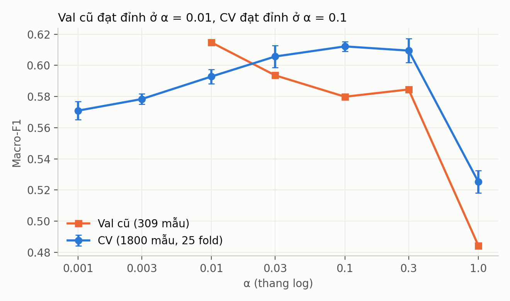
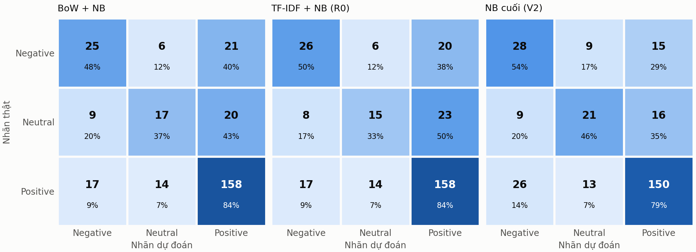
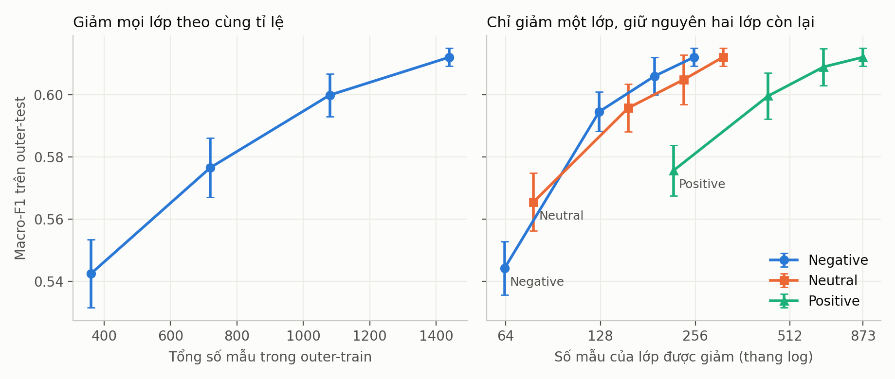
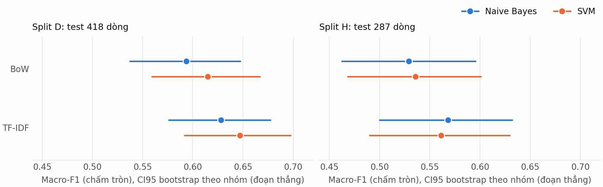
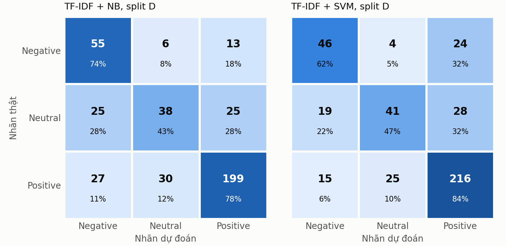
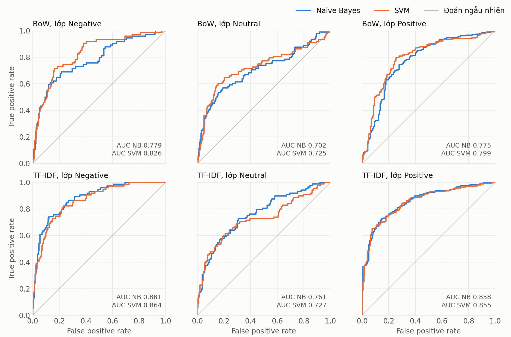

# Phân loại cảm xúc bình luận phim bằng Naive Bayes và so sánh với SVM

## Tóm tắt

Báo cáo này huấn luyện và đánh giá Multinomial Naive Bayes (NB) cho bài toán phân loại bình luận thành 3 nhãn Positive, Neutral, Negative, rồi so sánh với SVM của nhóm trên cùng dữ liệu. Chỉ số chính là macro-F1 vì dữ liệu lệch lớp.

| Câu hỏi | Kết quả | Số liệu |
|---|---|---|
| NB tốt nhất là cấu hình nào? | TF-IDF trên văn bản làm sạch lại `clean_v2`, cân bằng lớp, word (1,2), $\alpha=0.1$ | Macro-F1 CV 0.6411; test phim 0.5899, CI95 [0.5220, 0.6537] |
| Cải tiến so với baseline có thật không? | Có trên cross-validation | $\Delta$ so với R0 = +0.0483, CI95 [+0.0306, +0.0664] |
| BoW hay TF-IDF? | Macro-F1 chưa đủ bằng chứng để phân định. TF-IDF có macro-AUC cao hơn rõ | Với NB trên split D: $\Delta$ macro-F1 +0.0344, CI95 [-0.0074, +0.0762]; $\Delta$ macro-AUC +0.0810, CI95 [+0.0507, +0.1103] |
| NB hay SVM? | Không phát hiện khác biệt có ý nghĩa khi chấm trên cùng một tập test | Cùng TF-IDF: split D $\Delta$ = -0.0189, CI95 [-0.0634, +0.0248]; split H $\Delta$ = +0.0068, CI95 [-0.0508, +0.0658] |

**Lưu ý quan trọng:** hai con số đang có của nhóm, NB 0.5440 và SVM 0.6469, được chấm trên **hai tập test khác nhau** nên không so sánh được. Khoảng cách 0.103 giữa chúng gần như biến mất khi chấm cùng tập (mục 3.4). "Không phát hiện khác biệt" không có nghĩa là hai mô hình tương đương: test quá nhỏ để khẳng định điều đó.

## 1. Giới thiệu

### 1.1 Bài toán

Mỗi bình luận được gán một trong ba nhãn cảm xúc: Positive, Neutral, Negative. Đây là cách gán nhãn thứ nhất trong đề bài. Đầu vào là văn bản tiếng Việt trên mạng xã hội, ngắn, nhiều teencode và thiếu ngữ cảnh hội thoại. Dữ liệu lệch lớp: Positive chiếm 61.3%.

### 1.2 Phạm vi phần này

Theo `N7-PTKPDLVB.docx`, phần của Hiếu gồm huấn luyện NB, xuất metrics, viết lý thuyết NB và các chỉ số đánh giá, viết mục 3.3 và mục 3.4 (so sánh với SVM, có ROC/AUC). Dữ liệu chỉ thuộc nguồn số 3 trong đề bài, tức bình luận phim; đề tài của nhóm là 3A.

| Yêu cầu | Cách đáp ứng | Mục |
|---|---|---|
| Ít nhất 2 phương pháp trích chọn đặc trưng | BoW và TF-IDF | 3.3.2, 3.4 |
| Naive Bayes, chia tập huấn luyện và kiểm tra | Train/val/test, kèm cross-validation lồng nhau | 3.3 |
| Accuracy, Precision, Recall, F1, Confusion Matrix | Báo cáo đủ, cả macro và theo lớp | 3.3, 3.4 |
| So sánh đặc trưng và thuật toán | Bảng 2×2 (BoW, TF-IDF × NB, SVM) trên cùng split | 3.4 |
| ROC/AUC (kế hoạch nhóm) | ROC theo từng lớp, macro-AUC | 3.4.5 |
| Mô hình hiện đại (bổ sung của giảng viên) | Không thuộc phần NB, chỉ nêu làm tham chiếu | 3.4.7 |

Word Embeddings không được dùng với NB: đề bài chỉ cần 2 phương pháp, và MultinomialNB cần đặc trưng không âm, trong khi embedding có giá trị thực.

## 2. Cơ sở lý thuyết

### 2.1 Multinomial Naive Bayes

| Ký hiệu | Ý nghĩa | Kích thước |
|---|---|---|
| $N$, $V$, $C$ | Số văn bản, số term, số lớp ($C=3$) | vô hướng |
| $\mathbf x_d$ | Vector đặc trưng của văn bản $d$, $x_{dt}\ge 0$ | $\mathbb R^{V}$ |
| $y_d$ | Nhãn của văn bản $d$ | $\{1,\dots,C\}$ |
| $\pi_c$ | Xác suất tiên nghiệm (prior) của lớp $c$ | $\mathbb R^{C}$ |
| $\theta_{ct}$ | Xác suất của term $t$ trong lớp $c$ | $\mathbb R^{C\times V}$ |
| $\alpha$ | Tham số làm trơn (smoothing) | vô hướng |

Theo định lý Bayes, $P(c\mid\mathbf x)\propto P(c)\,P(\mathbf x\mid c)$. Mô hình multinomial (McCallum & Nigam, 1998) xem văn bản là một túi từ, các từ độc lập có điều kiện khi biết lớp. Lấy log để tránh underflow, quy tắc phân loại là:

$$\hat y=\arg\max_{c}\Big[\ln\pi_c+\sum_{t=1}^{V}x_{t}\ln\theta_{ct}\Big]$$

- $\ln\pi_c$ thể hiện độ phổ biến của lớp. Đặt $\pi_c=1/C$ (`fit_prior=False`) để mô hình không bị kéo về lớp Positive.
- $\sum_t x_t\ln\theta_{ct}$ cộng bằng chứng từ từng term: term xuất hiện nhiều trong lớp $c$ làm tăng điểm của lớp đó.

### 2.2 Làm trơn

Nếu một term chưa từng xuất hiện trong lớp $c$ thì $\theta_{ct}=0$ và $\ln\theta_{ct}$ không xác định. Làm trơn Lidstone cộng $\alpha$ vào mọi term:

$$\theta_{ct}=\frac{\alpha+\sum_{d:\,y_d=c}x_{dt}}{\alpha V+M_c},\qquad M_c=\sum_{t}\sum_{d:\,y_d=c}x_{dt}$$

Tỉ lệ $\alpha V/M_c$ cho biết smoothing lấn át dữ liệu đến đâu. Vì vậy $\alpha$ phụ thuộc thang đo của đặc trưng. Trên train, $V=4204$ và mỗi văn bản TF-IDF chuẩn L2 chỉ đóng góp khối lượng trung bình 3.82, nên $M_{\text{Negative}}$ khoảng 1126, so với 7553 khi dùng count. Thực nghiệm phù hợp với điều này: BoW chọn $\alpha$ từ 0.3 đến 0.5, TF-IDF chọn từ 0.01 đến 0.1 (Bảng 2).

### 2.3 Ví dụ số

Huấn luyện với $\alpha=1$, prior đều, trên ba văn bản: "phim hay" (Pos), "hay lắm" (Pos), "phim dở" (Neg). Từ vựng có $V=4$ term. Lớp Pos có tổng 4 lần xuất hiện nên mẫu số là $4+4=8$; lớp Neg có tổng 2 nên mẫu số là $4+2=6$.

| Term | $\theta_{\text{Pos},t}$ | $\theta_{\text{Neg},t}$ |
|---|---|---|
| phim | 2/8 = 0.250 | 2/6 = 0.333 |
| hay | 3/8 = 0.375 | 1/6 = 0.167 |
| lắm | 2/8 = 0.250 | 1/6 = 0.167 |
| dở | 1/8 = 0.125 | 2/6 = 0.333 |

Với văn bản mới "phim hay": điểm Pos là $\ln 0.250+\ln 0.375=-2.367$, điểm Neg là $\ln 0.333+\ln 0.167=-2.890$. Mô hình chọn Pos, với $P(\text{Pos}\mid\mathbf x)=0.628$. Kết quả này trùng với `sklearn.naive_bayes.MultinomialNB`.

### 2.4 Giả định độc lập

Giả định độc lập sai với ngôn ngữ: "không hay" là hai từ phụ thuộc nhau. Bigram giảm bớt vấn đề, đổi lại nhiều term hiếm hơn. Bằng chứng trùng lặp từ các term tương quan bị đếm nhiều lần, nên $P(c\mid\mathbf x)$ của NB thường quá tự tin. NB vẫn phân loại tốt vì quyết định chỉ cần thứ tự giữa các lớp đúng, không cần xác suất chính xác.

Mô hình multinomial định nghĩa cho số đếm nguyên. Thay count bằng TF-IDF làm mất ý nghĩa xác suất chặt chẽ, nhưng công thức vẫn tính được vì chỉ cần $x_{dt}\ge 0$. Rennie et al. (2003) xem các biến đổi TF, IDF và chuẩn hóa độ dài là cách chỉnh dữ liệu cho khớp mô hình hơn.

### 2.5 Biểu diễn đầu vào và cân bằng lớp

- **BoW:** $x_{dt}=f_{dt}$, số lần term $t$ xuất hiện trong văn bản $d$.
- **TF-IDF sublinear, chuẩn L2:** với $\mathrm{df}_t$ là số văn bản chứa term $t$,

$$v_{dt}=(1+\ln f_{dt})\Big(\ln\frac{1+N}{1+\mathrm{df}_t}+1\Big),\qquad x_{dt}=\frac{v_{dt}}{\lVert\mathbf v_d\rVert_2}$$

- **Cân bằng lớp:** gán trọng số $w_d=N/(C\,N_{y_d})$ khi cộng đặc trưng theo lớp, với $N_c$ là số văn bản của lớp $c$. Mỗi lớp khi đó đóng góp tổng trọng số văn bản bằng nhau, nên ước lượng $\theta$ của lớp hiếm được tăng ảnh hưởng.

**Độ phức tạp** (với $Z$ là số phần tử khác 0 của ma trận train, $Z_e$ của tập đánh giá): huấn luyện $O(Z+CV)$ thời gian, chỉ một lần quét dữ liệu; suy luận $O(Z_eC)$ thời gian; bộ nhớ tham số $O(CV)$.

### 2.6 Chỉ số đánh giá

**Ma trận nhầm lẫn:** $n_{ij}$ là số mẫu có nhãn thật $i$ bị dự đoán thành $j$. Các chỉ số dưới đây đều suy ra từ ma trận này:

$$\text{Accuracy}=\frac{\sum_c n_{cc}}{\sum_{ij}n_{ij}},\quad P_c=\frac{n_{cc}}{\sum_i n_{ic}},\quad R_c=\frac{n_{cc}}{\sum_j n_{cj}},\quad F1_c=\frac{2P_cR_c}{P_c+R_c}$$

- **Precision** $P_c$: trong các mẫu đoán là $c$, bao nhiêu mẫu đúng.
- **Recall** $R_c$: trong các mẫu thật sự là $c$, bao nhiêu mẫu được tìm ra.
- **Macro-F1:** trung bình cộng $F1_c$ của các lớp, mỗi lớp có trọng số như nhau.

**Ví dụ:** ở Hình 2, panel NB cuối, lớp Negative có 28 mẫu đúng, 35 mẫu đoán nhầm thành Negative và 24 mẫu Negative bị bỏ sót. Do đó $P=28/63=0.444$, $R=28/52=0.538$, $F1=0.487$.

**Vì sao chọn macro-F1:** trên test, mô hình luôn đoán Positive đạt accuracy 0.6585 nhưng macro-F1 chỉ 0.2647. Accuracy không phản ánh được khả năng nhận ra lớp thiểu số.

**ROC và AUC** (Fawcett, 2006): với mỗi ngưỡng trên điểm số của một lớp, ROC vẽ tỉ lệ dương đúng theo tỉ lệ dương sai. AUC là xác suất một mẫu dương ngẫu nhiên được chấm điểm cao hơn một mẫu âm ngẫu nhiên; 0.5 tương ứng đoán ngẫu nhiên. Với 3 lớp, mỗi lớp được tính theo kiểu One-vs-Rest, rồi lấy trung bình thành macro-AUC. Khác với F1, AUC không phụ thuộc ngưỡng quyết định.

### 2.7 Đánh giá độ bất định

- **Bootstrap** (Efron, 1979): lấy mẫu lại có hoàn lại để ước lượng CI95. Ở đây lấy mẫu theo **nhóm văn bản giống nhau**, vì các dòng trùng nội dung không độc lập. So sánh hai mô hình dùng paired bootstrap: cùng một mẫu lặp cho cả hai mô hình.
- **McNemar exact** (McNemar, 1947): kiểm định chênh lệch accuracy dựa trên các mẫu mà đúng một trong hai mô hình dự đoán đúng.
- **Holm** (Holm, 1979): hiệu chỉnh khi thực hiện nhiều phép so sánh trong cùng một họ.

## 3. Thực nghiệm và kết quả

### 3.1 Dữ liệu

Dữ liệu `Data/final_labeled_clean_v3.xlsx` có 2087 bình luận với 2019 văn bản khác nhau: 1280 Positive (61.3%), 438 Neutral (21.0%), 369 Negative (17.7%). Mô tả chi tiết và quy trình thu thập thuộc phần của Tuấn và Thắng.

**Phạm vi phim cần được xác nhận.** Đếm từ khóa trên `RAW Text` của toàn bộ 2087 dòng:

| Từ khóa | Số bình luận |
|---|---|
| "mưa đỏ" | 11 |
| "quảng trị", "thành cổ" | 0 |
| "trại buôn", "tbn" | 68 |
| "thiên đường máu", "tđm" | 65 |
| "lừa đảo", "buôn người", "bị lừa", "campuchia" | 102 |

*Bảng 1. Từ khóa trong dữ liệu. "Mưa đỏ" là phim về Thành cổ Quảng Trị.*

Đọc ngữ cảnh quanh từ khóa của cả 11 bình luận, "Mưa đỏ" đều được nhắc như một phim khác để so sánh, ví dụ "Năm ngoái có Mưa đỏ. Năm nay có Trại buôn người". Vì vậy dữ liệu nhiều khả năng thuộc về phim "Trại buôn người". Đây là suy luận: phần lớn bình luận không nêu tên phim và dữ liệu không có ID bài đăng, nên chỉ người thu thập mới xác nhận được.

### 3.2 Tiền xử lý và đặc trưng

Phần NB dùng hai đầu vào văn bản:

| Đầu vào | Nguồn | Đặc điểm | Dùng ở |
|---|---|---|---|
| `Clean Text` | Nhánh dữ liệu | Đã tách từ. Quan sát thấy dấu câu, chữ số, emoji và các từ như `nhưng`, `mà`, `nha` bị xóa | Đầu vào chính; so sánh với SVM |
| `clean_v2` | `build_data_v2.py`, làm sạch lại từ `RAW Text` | Giữ chữ số, `?`, `!`, emoji và tiểu từ; không bỏ stopword; chuẩn hóa teencode; bỏ URL và tên được tag; tách từ bằng `underthesea` | NB cuối |

`clean_v2` ra đời vì quá trình làm sạch cũ xóa mất tín hiệu hữu ích. Ví dụ trên train, 58 bình luận có dấu `?` và 41% trong số đó là Neutral, trong khi tỉ lệ nền của Neutral chỉ 21.5%.

**Không dùng ma trận `Data/vectorized/vectorized_data.joblib`** dù kế hoạch nhóm ghi như vậy, vì ma trận này fit TF-IDF trên toàn bộ dữ liệu (`src/vectorization.py:57`), khiến vocabulary và IDF chứa thông tin của tập test. Mọi vectorizer ở đây chỉ fit trên phần train của từng lần chia.

### 3.3 Huấn luyện và kết quả Naive Bayes

#### 3.3.1 Quy trình

Dữ liệu được chia theo nhóm `Clean Text` để các dòng giống hệt không nằm ở hai tập khác nhau. Gọi đây là **split H**:

| Tập | Số dòng | Số văn bản khác nhau | Negative | Neutral | Positive |
|---|---|---|---|---|---|
| Train | 1491 | 1441 | 259 (17.4%) | 320 (21.5%) | 912 (61.2%) |
| Val | 309 | 307 | 58 (18.8%) | 72 (23.3%) | 179 (57.9%) |
| Test | 287 | 271 | 52 (18.1%) | 46 (16.0%) | 189 (65.9%) |

Cấu hình được chọn theo hai cách và so sánh với nhau:

1. **Theo val:** fit trên train, chọn macro-F1 cao nhất trên val, lưới 72 cấu hình.
2. **Theo cross-validation (CV):** gộp train và val thành dev 1800 dòng, chia `StratifiedGroupKFold` 5 fold, lặp 5 lần (25 outer fold). Khi đánh giá một quy trình, cấu hình được chọn bằng inner CV 3 fold nằm trong outer-train, tức nested CV, để điểm không bị thổi phồng. Lưới gồm 84 cấu hình.

Một biến thể chỉ được chấp nhận khi **cận dưới CI95 của $\Delta$ macro-F1 so với đối chứng lớn hơn 0**. Quy tắc này được khóa trước khi chạy trong các bản đăng ký `experiment_plan*.md`.

#### 3.3.2 Kết quả train, val, test với BoW và TF-IDF

| Mô hình | n-gram | `min_df` | $\alpha$ | `fit_prior` | Số đặc trưng (train / train+val) |
|---|---|---|---|---|---|
| BoW, chọn theo val | (1, 2) | 2 | 0.5 | False | 4204 / 5151 |
| TF-IDF, chọn theo val (R0) | (1, 2) | 2 | 0.01 | False | 4204 / 5151 |
| BoW, chọn theo CV | (1, 2) | 2 | 0.3 | False | 4204 / 5151 |
| TF-IDF, chọn theo CV (R1) | (1, 2) | 3 | 0.1 | False | 2256 / 2746 |

*Bảng 2. Cấu hình MultinomialNB trên `Clean Text`.*

| Mô hình | Train | Val | Test, fit trên train | Test, fit trên train+val |
|---|---|---|---|---|
| BoW, chọn theo val | 0.8982 / 0.9142 | 0.6041 / 0.6861 | 0.5412 / 0.6725 | 0.5698 / 0.6969 |
| TF-IDF, chọn theo val (R0) | 0.9525 / 0.9598 | 0.6147 / 0.6958 | 0.5440 / 0.6760 | 0.5618 / 0.6934 |
| BoW, chọn theo CV | 0.9116 / 0.9242 | 0.5982 / 0.6796 | 0.5499 / 0.6760 | 0.5692 / 0.6864 |
| TF-IDF, chọn theo CV (R1) | 0.8878 / 0.9027 | 0.5813 / 0.6505 | 0.5290 / 0.6411 | 0.5395 / 0.6585 |

*Bảng 3. Macro-F1 / accuracy trên từng tập. Với hai dòng chọn theo CV, val thuộc dev dùng để chọn cấu hình nên điểm val lạc quan hơn thực tế.*

| Mô hình (fit trên train+val) | Accuracy | Macro-Precision | Macro-Recall | Macro-F1 | CI95 macro-F1 |
|---|---|---|---|---|---|
| BoW, chọn theo val | 0.6969 | 0.5812 | 0.5621 | 0.5698 | [0.4990, 0.6376] |
| TF-IDF, chọn theo val (R0) | 0.6934 | 0.5748 | 0.5540 | 0.5618 | [0.4907, 0.6295] |
| BoW, chọn theo CV | 0.6864 | 0.5720 | 0.5669 | 0.5692 | [0.4997, 0.6363] |
| TF-IDF, chọn theo CV (R1) | 0.6585 | 0.5354 | 0.5444 | 0.5395 | [0.4699, 0.6051] |

*Bảng 4. Kết quả trên test 287 mẫu. CI95 bootstrap theo nhóm, 10000 lần.*

Nhận xét:

- **Overfit rõ:** macro-F1 trên train từ 0.89 đến 0.95, trên val chỉ 0.58 đến 0.61. Đây là đặc điểm của mô hình nhiều đặc trưng thưa trên dữ liệu nhỏ.
- **Thêm dữ liệu có ích:** fit lại trên train+val tăng macro-F1 test ở cả bốn mô hình, từ +0.0105 đến +0.0286. Đây là quan sát mô tả, chưa kiểm định.
- **BoW và TF-IDF không phân định được trên test này:** chênh lệch +0.0080 (CI95 [-0.0368, +0.0525]) khi chọn theo val, +0.0297 (CI95 [-0.0207, +0.0787]) khi chọn theo CV, đều chứa 0. Trên CV, BoW thấp hơn TF-IDF -0.0089 (CI95 [-0.0211, +0.0028]), cũng chứa 0. Hai nguồn ngược dấu nhau, phù hợp với việc không có khác biệt lớn.

#### 3.3.3 Chọn $\alpha$ bằng val dễ bị overfit



*Hình 1. Macro-F1 theo $\alpha$, cố định word (1,2), `min_df=2`, `fit_prior=False`. Thanh sai số là độ lệch chuẩn qua 5 lần lặp.*

Val đạt đỉnh ở $\alpha=0.01$ (0.6147), còn CV đạt đỉnh ở $\alpha=0.1$ (0.6122) và tại $\alpha=0.01$ chỉ đạt 0.5928. Tune bằng nested CV tăng macro-F1 CV thêm +0.0200 (CI95 [+0.0079, +0.0327]). Mức tăng này không lặp lại trên test (R1 thấp hơn R0: -0.0224, CI95 [-0.0699, +0.0264]), nhưng CI đó vẫn chứa +0.0200, nên test không đủ để xác nhận hay bác bỏ.

#### 3.3.4 Các cải tiến đã thử

| Biến thể | Đối chứng | Macro-F1 CV | $\Delta$ | CI95 của $\Delta$ | Kết luận |
|---|---|---|---|---|---|
| Tune nested CV (R1) | R0 | 0.6128 ± 0.0065 | +0.0200 | [+0.0079, +0.0327] | **Chấp nhận** |
| Trọng số count (BoW) | R1 | 0.6039 ± 0.0108 | -0.0089 | [-0.0211, +0.0028] | Không đủ bằng chứng |
| Trọng số binary | R1 | 0.6073 ± 0.0094 | -0.0055 | [-0.0165, +0.0052] | Không đủ bằng chứng |
| ComplementNB | R1 | 0.5991 ± 0.0077 | -0.0137 | [-0.0235, -0.0044] | Kém hơn |
| NB-LR | R1 | 0.5640 ± 0.0114 | -0.0488 | [-0.0669, -0.0309] | Kém hơn |
| Đầu vào `Clean Text Old` | R1 | 0.6201 ± 0.0059 | +0.0073 | [-0.0075, +0.0219] | Không đủ bằng chứng |
| Thêm token meta từ RAW | R1 | 0.6130 ± 0.0063 | +0.0002 | [-0.0052, +0.0056] | Không đủ bằng chứng |
| Đánh dấu phủ định | R1 | 0.6102 ± 0.0060 | -0.0026 | [-0.0116, +0.0058] | Không đủ bằng chứng |
| Char n-gram | R1 | 0.5989 ± 0.0045 | -0.0140 | [-0.0320, +0.0040] | Không đủ bằng chứng |
| Word + char n-gram | R1 | 0.6140 ± 0.0041 | +0.0012 | [-0.0152, +0.0175] | Không đủ bằng chứng |
| Chọn đặc trưng chi²/MI | R1 | 0.6046 ± 0.0042 | -0.0082 | [-0.0152, -0.0013] | Kém hơn |
| Class weight balanced | R1 | 0.6212 ± 0.0107 | +0.0084 | [-0.0020, +0.0181] | Không đủ bằng chứng |
| Oversample | R1 | 0.6152 ± 0.0064 | +0.0024 | [-0.0072, +0.0117] | Không đủ bằng chứng |
| Offset log-prior | R1 | 0.6079 ± 0.0054 | -0.0049 | [-0.0130, +0.0034] | Không đủ bằng chứng |
| Lọc nhãn nghi nhiễu | R1 | 0.5980 ± 0.0096 | -0.0148 | [-0.0251, -0.0046] | Kém hơn |
| Augmentation | R1 | 0.6152 ± 0.0093 | +0.0024 | [-0.0055, +0.0102] | Không đủ bằng chứng |
| Làm sạch lại `clean_v2` (V1) | R1 | 0.6241 ± 0.0045 | +0.0113 | [-0.0029, +0.0256] | Không đủ bằng chứng |
| `clean_v2` + class weight balanced (V2) | V1 | 0.6411 ± 0.0068 | +0.0170 | [+0.0073, +0.0269] | **Chấp nhận** |
| V2 + dữ liệu ngoài UIT-VSMEC | V2 | 0.6449 ± 0.0117 | +0.0038 | [-0.0043, +0.0118] | Không đủ bằng chứng |
| V2 + dữ liệu ngoài UIT-VSFC | V2 | 0.6345 ± 0.0093 | -0.0066 | [-0.0172, +0.0043] | Không đủ bằng chứng |
| V2 + cả hai bộ dữ liệu ngoài | V2 | 0.6453 ± 0.0033 | +0.0042 | [-0.0071, +0.0153] | Không đủ bằng chứng |
| V2 + 8 nhãn đề xuất sửa | V2 | 0.6386 ± 0.0101 | -0.0025 | [-0.0078, +0.0027] | Không đủ bằng chứng |

*Bảng 5. Thí nghiệm trên CV: dev 1800 dòng, 25 outer fold, nested, bootstrap theo nhóm 5000 lần. Điểm luôn tính trên dòng phim với nhãn gốc. Chi tiết từng thí nghiệm ở `reports/Bao_cao_Cai_thien_Naive_Bayes.md`.*

Trong 22 thí nghiệm ở Bảng 5, chỉ hai thay đổi được chấp nhận: tune bằng nested CV, và cân bằng lớp trên `clean_v2`. Riêng `clean_v2` chưa đủ bằng chứng khi so với R1, nhưng được giữ làm nền theo bản đăng ký vì chỉ nó áp dụng được cho dữ liệu ngoài. So với baseline R0, cấu hình V2 tăng **+0.0483 (CI95 [+0.0306, +0.0664])** trên CV.

Dữ liệu ngoài không giúp ích: trọng số $\lambda$ của mỗi dòng dữ liệu ngoài luôn được chọn ở mức thấp nhất của lưới (0.03) trong cả 25 fold. Bình luận cảm xúc mạng xã hội và phản hồi sinh viên có vẻ khác miền với bình luận phim, nên không thay thế được dữ liệu cùng miền.

#### 3.3.5 Mô hình NB cuối cùng

**Cấu hình V2:** đầu vào `clean_v2`, TF-IDF sublinear chuẩn L2, word (1,2), `min_df=1`, $\alpha=0.1$, `fit_prior=False`, cân bằng lớp, 29433 term trên dev. Cấu hình được khóa trong `experiments_v2/final_candidates_v2.json` **trước khi** chấm trên test-v2 và test phim, rồi fit trên 1800 dòng dev.

Ước lượng tốt nhất cho hiệu năng của quy trình là điểm nested CV: **macro-F1 0.6411 ± 0.0068**, CI95 [0.6195, 0.6624], accuracy 0.6969.

| Mô hình | Accuracy | Macro-Precision | Macro-Recall | Macro-F1 | CI95 macro-F1 |
|---|---|---|---|---|---|
| Luôn đoán Positive | 0.6585 | | | 0.2647 | |
| R0, fit trên train | 0.6760 | 0.5602 | 0.5329 | 0.5440 | [0.4723, 0.6127] |
| R0, fit trên train+val | 0.6934 | 0.5748 | 0.5540 | 0.5618 | [0.4907, 0.6295] |
| R1, fit trên train+val | 0.6585 | 0.5354 | 0.5444 | 0.5395 | [0.4699, 0.6051] |
| `X_old_bal` (thăm dò), fit trên train+val | 0.7038 | 0.6045 | 0.5656 | 0.5789 | [0.5066, 0.6458] |
| R0v2 (cấu hình R0 trên `clean_v2`) | 0.6969 | 0.5979 | 0.5668 | 0.5772 | [0.5076, 0.6432] |
| **NB cuối (V2)** | **0.6934** | **0.5872** | **0.5962** | **0.5899** | **[0.5220, 0.6537]** |

*Bảng 6. Kết quả trên test phim 287 mẫu, 271 nhóm. Chỉ để mô tả, không dùng để chọn mô hình (mục 3.5). `X_old_bal` là cấu hình `Clean Text Old` + cân bằng lớp, được thêm sau khi xem kết quả CV.*

| Lớp | Precision | Recall | F1 | Support |
|---|---|---|---|---|
| Negative | 0.444 | 0.538 | 0.487 | 52 |
| Neutral | 0.488 | 0.457 | 0.472 | 46 |
| Positive | 0.829 | 0.794 | 0.811 | 189 |

*Bảng 7. Kết quả theo lớp của NB cuối trên test phim.*



*Hình 2. Ma trận nhầm lẫn trên test phim, mô hình fit trên train+val. Số lớn là số mẫu, số nhỏ là tỉ lệ theo hàng.*

So với BoW và R0, NB cuối đổi một phần recall Positive (79% so với 84%) lấy recall Neutral (46% so với 37% và 33%) và Negative (54% so với 48% và 50%). Đây là tác dụng mong muốn của cân bằng lớp. Điểm test 0.5899 thấp hơn CV 0.6411, nhưng CI95 của test vẫn chứa 0.6411.

**Kiểm chứng ngoài miền.** Theo bản đăng ký v2, các mô hình được chấm trên test-v2: 1311 câu mạng xã hội từ UIT-VSMEC, không phải bình luận phim, nhãn được quy đổi từ cảm xúc. Mô hình chỉ học trên dữ liệu phim.

| Mô hình | Accuracy | Macro-Precision | Macro-Recall | Macro-F1 | CI95 macro-F1 |
|---|---|---|---|---|---|
| R0v2 | 0.3791 | 0.3782 | 0.3761 | 0.3644 | [0.3381, 0.3908] |
| NB cuối (V2) | 0.4027 | 0.3970 | 0.3995 | 0.3892 | [0.3618, 0.4157] |

*Bảng 8. Kết quả trên test-v2. Luôn đoán Positive, lớp đa số của dữ liệu phim, đạt accuracy 0.3105, macro-F1 0.1579. Luôn đoán Negative, lớp đa số của chính test-v2, đạt accuracy 0.4836, macro-F1 0.2173.*

NB cuối tốt hơn R0v2: $\Delta$ = +0.0249, CI95 [+0.0049, +0.0443], $p_{\text{Holm}}$ = 0.035. Đây là phép so sánh đã đăng ký trước duy nhất, trên dữ liệu chưa từng nhìn, ủng hộ việc tune và cân bằng lớp. Nó chỉ so hai cấu hình cùng dùng `clean_v2`, nên không kiểm chứng được bản thân `clean_v2`.

Điểm tuyệt đối rất thấp: accuracy của NB còn thấp hơn việc luôn đoán lớp đa số của test-v2, dù macro-F1 cao hơn. Mô hình học trên bình luận phim không chuyển sang miền khác được, và kết quả này không nói lên hiệu năng trên bình luận phim.

#### 3.3.6 Mô hình học được gì và sai ở đâu

| Lớp | Đặc trưng tiêu biểu |
|---|---|
| Negative | `dở_nha`, `thua`, `để tiền`, `rác`, `xàm`, `lộn_xộn`, `nhảm`, `thỏ`, `nhồi_nhét` |
| Neutral | `không ạ`, `dưới 18`, `tuổi xem`, `trở lên`, `suất`, `có cảnh`, `cảnh nóng` |
| Positive | `hay nha`, `đáng xem`, `xứng_đáng`, `quá hay`, `xem ngay`, `rất hay`, `10 10` |

*Bảng 9. Trích một số term có chênh lệch $\ln\theta_{ct}$ lớn nhất so với lớp cao nhất còn lại, trong số term xuất hiện ở ít nhất 5 văn bản dev.*

Negative và Positive học đúng từ đánh giá. Neutral chủ yếu là câu hỏi về độ tuổi, suất chiếu và nội dung, nghĩa là lớp này gần với "câu hỏi" hơn là "trung tính". Term `thỏ` có thể là tên một phim khác được nhắc tới. Như vậy mô hình có nguy cơ học theo chủ đề thay vì cảm xúc.

Đọc 30 mẫu sai trên dev (R1) cho thấy nguyên nhân thường gặp nhất là nhãn mơ hồ (6 mẫu), khen chê lẫn lộn (5), thiếu ngữ cảnh hội thoại (4), so sánh với phim khác (4). Chỉ 2 mẫu do phủ định. Phần lớn các lỗi này nằm ngoài khả năng biểu diễn của bag-of-n-grams. Việc phân loại lỗi do trợ lý AI thực hiện, chưa có người thứ hai kiểm tra, nên chỉ mang tính định hướng.



*Hình 3. Learning curve trên dev. Trái: giảm mọi lớp. Phải: chỉ giảm một lớp.*

Macro-F1 vẫn tăng khi thêm dữ liệu (0.5425 ở 25% lên 0.6122 ở 100% outer-train), và giữ 25% mẫu Negative làm điểm tụt nhiều nhất (0.5443). Do đó nên ưu tiên thu thêm Negative, sau đó Neutral.

### 3.4 Đánh giá và so sánh với SVM

#### 3.4.1 Vì sao không so sánh trực tiếp được

Kế hoạch nhóm ghi hai mô hình dùng cùng tập Train/Test, nhưng thực tế hai nhánh đã chia riêng:

| | Split H (NB) | Split D (SVM) |
|---|---|---|
| Cách chia | Theo nhóm `Clean Text`, có val | `train_test_split(test_size=0.2, stratify=y, random_state=18)` |
| Kích thước | 1491 / 309 / 287 | 1669 / 418 |

*Bảng 10. Hai cách chia đang có trong nhóm.*

Không thể chỉ đem mô hình của bên này chấm trên test của bên kia: 365/418 dòng test D nằm trong dev H, và 234/287 dòng test H nằm trong train D. Vì vậy mỗi so sánh dưới đây đều **huấn luyện lại trên cùng một split**.

#### 3.4.2 Thiết kế

Thiết kế được khóa trước khi chạy trong `experiment_plan_v3.md`. Cả hai mô hình dùng cùng đầu vào `Clean Text`.

- **Split D (so sánh chính):** SVM giữ nguyên hai mô hình đã lưu của Doanh (OvO `LinearSVC`, word (1,2), `class_weight="balanced"`, $C=0.03$ với BoW và $C=0.3$ với TF-IDF), tái lập đúng macro-F1 0.6148 và 0.6469. NB được chọn lại từ đầu bằng đúng 5 fold của Doanh, chỉ trên 1669 dòng train. Không dùng lại cấu hình NB cũ vì chúng được chọn trên dữ liệu chứa phần lớn test D.
- **Lưới NB:** n-gram tối đa $\{1,2,3\}$, `min_df` $\{1,2,3\}$, 7 giá trị $\alpha$, `fit_prior`, cân bằng lớp, và `sublinear_tf` với TF-IDF. Kết quả: BoW (1,3), `min_df=2`, $\alpha=0.3$, không cân bằng lớp; TF-IDF (1,2), `min_df=1`, $\alpha=0.3$, cân bằng lớp.
- **Họ so sánh:** 4 phép, Holm, paired bootstrap 10000 lần theo nhóm trên macro-F1, kèm McNemar cho accuracy.
- **Split H (đối chiếu):** SVM được chọn lại bằng đúng quy trình hai bước của Doanh, nhưng chỉ trên dev. Cả NB và SVM dùng cùng 25 outer fold, fit trên 1800 dòng, chấm trên 287 dòng.

#### 3.4.3 Kết quả trên split D

| Mô hình | Accuracy | Macro-Precision | Macro-Recall | Macro-F1 | CI95 macro-F1 | Macro-AUC | CI95 macro-AUC |
|---|---|---|---|---|---|---|---|
| NB + BoW | 0.6866 | 0.6037 | 0.5866 | 0.5937 | [0.5374, 0.6474] | 0.7521 | [0.7098, 0.7957] |
| NB + TF-IDF | 0.6986 | 0.6224 | 0.6508 | 0.6281 | [0.5762, 0.6774] | 0.8332 | [0.7983, 0.8669] |
| SVM + BoW | 0.6986 | 0.6237 | 0.6102 | 0.6148 | [0.5595, 0.6669] | 0.7835 | [0.7416, 0.8244] |
| SVM + TF-IDF | 0.7249 | 0.6556 | 0.6438 | 0.6469 | [0.5918, 0.6974] | 0.8150 | [0.7788, 0.8497] |

*Bảng 11. So sánh 2×2 trên test D 418 dòng. Đối chứng luôn đoán Positive đạt accuracy 0.6124, macro-F1 0.2532.*

| So sánh | $\Delta$ macro-F1 | CI95 của $\Delta$ | $p_{\text{Holm}}$ | A đúng B sai / A sai B đúng | p McNemar | $\Delta$ macro-AUC | CI95 của $\Delta$ AUC |
|---|---|---|---|---|---|---|---|
| NB BoW so với SVM BoW | -0.0211 | [-0.0726, +0.0310] | 0.818 | 36 / 41 | 0.649 | -0.0314 | [-0.0678, +0.0065] |
| NB TF-IDF so với SVM TF-IDF | -0.0189 | [-0.0634, +0.0248] | 0.818 | 26 / 37 | 0.207 | +0.0182 | [-0.0008, +0.0375] |
| NB TF-IDF so với NB BoW | +0.0344 | [-0.0074, +0.0762] | 0.459 | 30 / 25 | 0.590 | +0.0810 | [+0.0507, +0.1103] |
| SVM TF-IDF so với SVM BoW | +0.0321 | [-0.0078, +0.0730] | 0.459 | 24 / 13 | 0.099 | +0.0314 | [+0.0156, +0.0496] |

*Bảng 12. Họ so sánh trên test D. Holm chỉ áp dụng cho macro-F1. $\Delta$ macro-AUC là chỉ số phụ, bootstrap 2000 lần, chưa hiệu chỉnh đa so sánh.*

- **Không có phép so sánh macro-F1 nào có ý nghĩa sau Holm.** SVM có điểm cao hơn NB khoảng 0.02, nhưng CI95 còn chứa cả các giá trị có lợi cho NB.
- **TF-IDF có xu hướng tốt hơn BoW** ở cả hai thuật toán, mức tăng tương tự nhau (+0.0344 và +0.0321) dù chưa có ý nghĩa trên macro-F1. Trên macro-AUC, CI95 nằm hẳn trên 0 ở cả hai.
- **Độ bền:** split D không chia theo nhóm nên 19/418 dòng test trùng y hệt văn bản trong train. Bỏ 19 dòng này, kết quả gần như không đổi: NB TF-IDF 0.6254, SVM TF-IDF 0.6449, $\Delta$ = -0.0195, CI95 [-0.0651, +0.0257].



*Hình 4. Macro-F1 của NB và SVM trên cùng split. Chênh lệch giữa hai thuật toán nhỏ hơn nhiều so với chênh lệch giữa hai tập test.*

#### 3.4.4 Theo từng lớp

| Mô hình | Negative P / R / F1 | Neutral P / R / F1 | Positive P / R / F1 |
|---|---|---|---|
| NB + BoW | 0.521 / 0.500 / 0.510 | 0.514 / 0.432 / 0.469 | 0.777 / 0.828 / 0.802 |
| NB + TF-IDF | 0.514 / 0.743 / 0.608 | 0.514 / 0.432 / 0.469 | 0.840 / 0.777 / 0.807 |
| SVM + BoW | 0.550 / 0.446 / 0.493 | 0.526 / 0.568 / 0.546 | 0.795 / 0.816 / 0.805 |
| SVM + TF-IDF | 0.575 / 0.622 / 0.597 | 0.586 / 0.466 / 0.519 | 0.806 / 0.844 / 0.824 |

*Bảng 13. Precision, recall, F1 theo lớp trên test D (support: Negative 74, Neutral 88, Positive 256).*



*Hình 5. Ma trận nhầm lẫn của NB và SVM với TF-IDF trên test D.*

Hai mô hình có kiểu sai khác nhau. NB TF-IDF tìm được nhiều Negative hơn (recall 0.743 so với 0.622) nhưng đoán nhầm nhiều mẫu khác thành Negative hơn (precision 0.514 so với 0.575). SVM nghiêng về Positive hơn (recall 0.844 so với 0.777). Với cả hai mô hình, Neutral là lớp khó nhất.

#### 3.4.5 ROC và AUC

| Mô hình | Negative | Neutral | Positive | Macro-AUC |
|---|---|---|---|---|
| NB + BoW | 0.779 | 0.702 | 0.775 | 0.752 |
| NB + TF-IDF | 0.881 | 0.761 | 0.858 | 0.833 |
| SVM + BoW | 0.826 | 0.725 | 0.799 | 0.784 |
| SVM + TF-IDF | 0.864 | 0.727 | 0.855 | 0.815 |

*Bảng 14. AUC One-vs-Rest trên test D. Điểm số của NB là `predict_proba`, của SVM là `decision_function`.*



*Hình 6. Đường ROC One-vs-Rest trên test D.*

Macro-AUC của NB TF-IDF cao hơn SVM TF-IDF +0.0182, CI95 [-0.0008, +0.0375], vừa đủ chứa 0. Macro-AUC của NB nhạy với đặc trưng hơn SVM: TF-IDF tăng +0.0810 cho NB, +0.0314 cho SVM. Có thể giải thích là chuẩn hóa L2 loại bỏ ảnh hưởng của độ dài văn bản lên độ lớn điểm NB, giúp so sánh điểm giữa các văn bản, là điều AUC đo. Đây là giả thuyết, chưa kiểm chứng.

Cần đọc AUC của SVM một cách thận trọng. Điểm của OvO trong scikit-learn là số phiếu cộng với độ tin cậy đã được co lại, nên thô hơn khoảng cách đến siêu phẳng, và có thể làm AUC của SVM thấp hơn khả năng xếp hạng thực của nó.

#### 3.4.6 Đối chiếu trên split H

| Mô hình | Accuracy | Macro-Precision | Macro-Recall | Macro-F1 | CI95 macro-F1 | Macro-AUC | CI95 macro-AUC |
|---|---|---|---|---|---|---|---|
| NB + BoW | 0.6516 | 0.5287 | 0.5329 | 0.5292 | [0.4625, 0.5956] | 0.7549 | [0.6990, 0.8091] |
| NB + TF-IDF | 0.6585 | 0.5612 | 0.5832 | 0.5681 | [0.5001, 0.6321] | 0.8156 | [0.7675, 0.8603] |
| SVM + BoW | 0.6516 | 0.5332 | 0.5434 | 0.5356 | [0.4683, 0.6010] | 0.7500 | [0.6943, 0.8033] |
| SVM + TF-IDF | 0.6899 | 0.5768 | 0.5501 | 0.5612 | [0.4901, 0.6296] | 0.7829 | [0.7332, 0.8315] |

*Bảng 15. So sánh 2×2 trên test H 287 dòng, chỉ để mô tả. Tất cả dùng `Clean Text`. Cấu hình NB khác NB cuối vì được chọn lại trên lưới chung với SVM.*

Với TF-IDF, thứ tự đảo lại so với split D: NB cao hơn SVM +0.0068, CI95 [-0.0508, +0.0658]. Với BoW, $\Delta$ = -0.0064, CI95 [-0.0764, +0.0642]. Không so sánh NB với SVM nào có ý nghĩa.

SVM TF-IDF giảm từ 0.6469 trên test D xuống 0.5612 trên test H, tức 0.0857, dù tập huấn luyện ở split H lớn hơn. NB TF-IDF giảm 0.0600. Chênh lệch do đổi tập test lớn gấp nhiều lần chênh lệch giữa hai thuật toán (0.0189 và 0.0068). Điều này cho thấy test H khó hơn với cả hai mô hình, và giải thích phần lớn khoảng cách giữa 0.5440 của NB và 0.6469 của SVM. Nguyên nhân cụ thể chưa rõ; test H ít Neutral hơn (46 dòng) nên F1 lớp này rất nhạy với vài dự đoán.

Thứ hạng cũng đảo giữa CV và test. Trên đúng 5 fold của Doanh, điểm CV của NB cao hơn SVM: 0.6076 so với 0.5862 với BoW, 0.6252 so với 0.6128 với TF-IDF. Trên test D, SVM lại cao hơn. Điểm CV ở đây là điểm tốt nhất của lưới nên lạc quan, và lưới của NB lớn hơn nên có thể lạc quan hơn.

#### 3.4.7 Nhận xét chung

- **Hiệu năng:** trên dữ liệu này chưa đủ bằng chứng để nói NB hay SVM tốt hơn. Chênh lệch ước lượng nhỏ, đổi dấu giữa các tập, và CI95 rộng khoảng ±0.05 đến ±0.07 trên từng tập test. Kết quả không chứng minh hai mô hình tương đương; chênh lệch thật cỡ 0.02 đến 0.05 vẫn có thể tồn tại.
- **Điểm mạnh của NB:** huấn luyện một lần quét dữ liệu, rất nhanh, dễ giải thích qua $\theta_{ct}$ (Bảng 9), và tìm lớp Negative tốt hơn khi cân bằng lớp.
- **Điểm mạnh của SVM:** accuracy và precision cao hơn trên test D (0.7249 so với 0.6986), nghiêng về lớp đa số.
- **Khi kết hợp:** soft voting NB + LogReg (`clean_v2`) đạt macro-F1 CV 0.6481, nhưng chưa được chấp nhận so với NB thuần ($\Delta$ = +0.0070, CI95 [-0.0009, +0.0147]).
- **Tham chiếu mô hình hiện đại:** PhoBERT (Nguyen & Nguyen, 2020) đạt macro-F1 CV 0.6754 ± 0.0099, cao hơn NB cuối +0.0343 (CI95 [+0.0106, +0.0579]), rõ nhất ở lớp Neutral (F1 0.6327 so với 0.5502). Trung bình xác suất PhoBERT với soft voting NB + LogReg đạt 0.6978 trên CV và 0.6486 trên test phim (CI95 [0.5807, 0.7124]). Trên test-v2, mô hình này đạt 0.5499, cao hơn soft voting +0.1630 (CI95 [+0.1320, +0.1937]). Phần này không thuộc nhiệm vụ NB và mô hình cuối mới chạy với một seed.

### 3.5 Hạn chế

- **Test nhỏ:** CI95 macro-F1 rộng khoảng ±0.07 trên test H và ±0.05 trên test D, nên không phân biệt được chênh lệch 0.02 đến 0.03. Vì vậy CV được dùng để chọn mô hình.
- **Test phim đã bị nhìn nhiều lần:** bốn mô hình ban đầu, đợt chấm v1, rồi đợt này. Mọi điểm test phim ở mục 3.3 chỉ mang tính mô tả.
- **Test D không hoàn toàn mới với NB:** các thí nghiệm NB trước đó dùng dev chứa 365/418 dòng test D. Mô hình NB ở mục 3.4 được chọn lại từ đầu, nhưng thiết kế lưới vẫn có thể chịu ảnh hưởng gián tiếp.
- **Đa so sánh trên CV:** quy tắc CI95 không hiệu chỉnh cho 22 thí nghiệm. V2 so với V1 vẫn đạt sau Holm trong họ của vòng v2 ($p_{\text{Holm}}$ = 0.0064).
- **Cấu hình cuối chọn trên chính 25 outer fold:** điểm của nó (0.6447) lạc quan, nên báo cáo dùng điểm nested 0.6411.
- **So sánh NB với SVM dùng `Clean Text`:** NB cuối dùng `clean_v2` chưa được so sánh trực tiếp với SVM trên cùng đầu vào.
- **Phạm vi phim chưa xác nhận** (mục 3.1).
- **Nhãn:** chỉ có một nhãn cuối, không có số liệu đồng thuận giữa người gán, nên trần điểm do nhiễu nhãn chưa biết. Dữ liệu không có ID thread, nên chưa kiểm tra được rò rỉ theo thread.

## 4. Kết luận

NB cuối dùng TF-IDF trên văn bản làm sạch lại, cân bằng lớp, đạt macro-F1 0.6411 trên nested CV, tăng +0.0483 so với baseline. Hai thay đổi được chấp nhận là chọn $\alpha$ bằng CV thay vì một tập val nhỏ, và cân bằng lớp trên `clean_v2`. Riêng `clean_v2` chưa đạt quy tắc chấp nhận khi đứng một mình. Các biến thể khác của NB, dữ liệu ngoài và kỹ thuật tăng dữ liệu không mang lại lợi ích đã được chứng minh.

Khi so sánh trên cùng một tập test, không phát hiện khác biệt có ý nghĩa giữa NB và SVM. Khoảng cách 0.103 trước đây chủ yếu do hai bên chấm trên hai tập test khác nhau. TF-IDF có xu hướng tốt hơn BoW ở cả hai thuật toán, rõ nhất trên macro-AUC.

**Hướng tiếp theo:**

1. Nhóm xác nhận nguồn dữ liệu và thống nhất một split dùng chung.
2. Thu thêm bình luận Negative và Neutral, chốt hướng dẫn gán nhãn cho câu hỏi và ý định đi xem.
3. Dùng mô hình hiện đại nếu ưu tiên hiệu năng, giữ NB làm baseline nhanh và dễ giải thích.

## 5. Tài liệu tham khảo

Trạng thái xác minh ghi cho từng mục, kiểm tra ngày 2026-11-05 và 2026-11-06.

1. Efron, B. (1979). Bootstrap Methods: Another Look at the Jackknife. *The Annals of Statistics*, 7(1), 1–26. DOI: [10.1214/aos/1176344552](https://doi.org/10.1214/aos/1176344552). Xác minh metadata qua Crossref, chưa đọc toàn văn.
2. Fawcett, T. (2006). An introduction to ROC analysis. *Pattern Recognition Letters*, 27(8), 861–874. DOI: [10.1016/j.patrec.2005.10.010](https://doi.org/10.1016/j.patrec.2005.10.010). Xác minh metadata qua Crossref, chưa đọc toàn văn.
3. Ho, V., Nguyen, D., Nguyen, D., Pham, L., Nguyen, K., & Nguyen, N. (2019). Emotion Recognition for Vietnamese Social Media Text. *PACLING 2019*. Dữ liệu UIT-VSMEC, giấy phép CC BY-NC-SA 4.0. Thông tin lấy từ dataset card, chưa đọc toàn văn.
4. Holm, S. (1979). A Simple Sequentially Rejective Multiple Test Procedure. *Scandinavian Journal of Statistics*, 6(2), 65–70. JSTOR 4615733. Chưa xác minh được qua Crossref, chưa đọc toàn văn.
5. McCallum, A., & Nigam, K. (1998). A comparison of event models for naive Bayes text classification. Tác giả và năm xác minh qua OpenAlex; hội nghị *AAAI-98 Workshop on Learning for Text Categorization* chưa đối chiếu; chưa đọc toàn văn.
6. McNemar, Q. (1947). Note on the Sampling Error of the Difference Between Correlated Proportions or Percentages. *Psychometrika*, 12(2), 153–157. DOI: [10.1007/BF02295996](https://doi.org/10.1007/BF02295996). Xác minh metadata qua Crossref, chưa đọc toàn văn.
7. Nguyen, D. Q., & Nguyen, A. T. (2020). PhoBERT: Pre-trained language models for Vietnamese. *Findings of EMNLP 2020*, 1037–1042. DOI: [10.18653/v1/2020.findings-emnlp.92](https://doi.org/10.18653/v1/2020.findings-emnlp.92). Xác minh metadata qua Crossref, chưa đọc toàn văn.
8. Nguyen, K. V., Nguyen, V. D., Nguyen, P. X.-V., Truong, T. T.-H., & Nguyen, N. L.-T. (2018). UIT-VSFC: Vietnamese Students' Feedback Corpus for Sentiment Analysis. *KSE 2018*. Dữ liệu UIT-VSFC, giấy phép CC BY-NC-SA 4.0. Thông tin lấy từ dataset card, chưa đọc toàn văn.
9. Pedregosa, F., et al. (2011). Scikit-learn: Machine Learning in Python. *Journal of Machine Learning Research*, 12, 2825–2830. Tên, năm, tạp chí xác minh qua OpenAlex; tập và trang chưa đối chiếu.
10. Rennie, J. D. M., Shih, L., Teevan, J., & Karger, D. R. (2003). Tackling the Poor Assumptions of Naive Bayes Text Classifiers. *Proceedings of ICML-2003*, 616–623. Đã đọc bản PDF ở đợt trước.
11. Wang, S., & Manning, C. D. (2012). Baselines and Bigrams: Simple, Good Sentiment and Topic Classification. *Proceedings of the 50th Annual Meeting of the ACL*, 90–94. Đã đọc bản PDF ở đợt trước. Nguồn của biến thể NB-LR.
12. Wei, J., & Zou, K. (2019). EDA: Easy Data Augmentation Techniques for Boosting Performance on Text Classification Tasks. arXiv:[1901.11196](https://arxiv.org/abs/1901.11196). Xác minh metadata qua arXiv API. Nguồn của thí nghiệm augmentation.

## Phụ lục: Tái lập

Chạy từ gốc repo, đúng thứ tự vì bước sau đọc kết quả bước trước. `a1` từ chối ghi đè ứng viên đã khóa, `a2` từ chối chấm lại nếu không đặt `FINAL_TEST_REPRO=1`.

```bash
V=models/Naive_Bayes/.venv/bin/python
export OMP_NUM_THREADS=1 OPENBLAS_NUM_THREADS=1 MKL_NUM_THREADS=1

$V models/Naive_Bayes/report_runs/a1_lock_v2.py        # khóa ứng viên v2, không đọc test
$V models/Naive_Bayes/report_runs/a2_score_v2.py       # chấm test-v2 và test phim, cần GPU cho PhoBERT
$V models/Naive_Bayes/report_runs/b_train_val_test.py  # BoW và TF-IDF trên train/val/test
$V models/Naive_Bayes/report_runs/c_nb_vs_svm.py       # NB và SVM trên split D và split H
$V models/Naive_Bayes/report_runs/d_figures.py         # vẽ hình
$V models/Naive_Bayes/report_runs/e_tables.py          # sinh bảng từ CSV
$V models/Naive_Bayes/report_runs/f_check_report.py    # đối chiếu số trong báo cáo với CSV
```

**Môi trường:** Python 3.9.21, scikit-learn 1.6.1, NumPy 2.0.2, SciPy 1.13.1, pandas 2.3.3, PyTorch 2.8.0+cu128, NVIDIA A100-PCIE-40GB. Commit gốc `7a78a4c`; các file trong `models/Naive_Bayes/` chưa được commit. Seed 42; fold seed 0 đến 4; split D dùng seed 18.

**Kiểm tra đã thực hiện:** hash của split và dữ liệu khớp bản đăng ký; đường scikit-learn tái lập 100% dự đoán OOF của V2, LR1, HV2 và tái lập đúng 0.6147, 0.5440, 0.5618, 0.5395; mô hình SVM tái lập đúng 0.6148, 0.6469; bootstrap, McNemar và Holm được đối chiếu với bản cài đặt naive trong `report_runs/common.py`.

| Đường dẫn | Nội dung |
|---|---|
| `experiment_plan.md`, `experiment_plan_v2.md`, `experiment_plan_v3.md` | Bản đăng ký thí nghiệm và nhật ký sai lệch |
| `experiments/`, `experiments_v2/` | Kết quả CV, dự đoán từng mẫu, kết quả test |
| `experiments_v2/final_candidates_v2.json` | Ứng viên v2 đã khóa |
| `experiments_report/b_*`, `c_*` | Kết quả phần train/val/test và so sánh NB với SVM |
| `experiments_report/report_tables.md` | Bảng sinh tự động từ CSV |
| `reports/Bao_cao_Cai_thien_Naive_Bayes.md` | Báo cáo chi tiết từng thí nghiệm cải tiến |
| `datasets/label_audit.csv` | Đề xuất kiểm toán nhãn, chưa có người duyệt |
