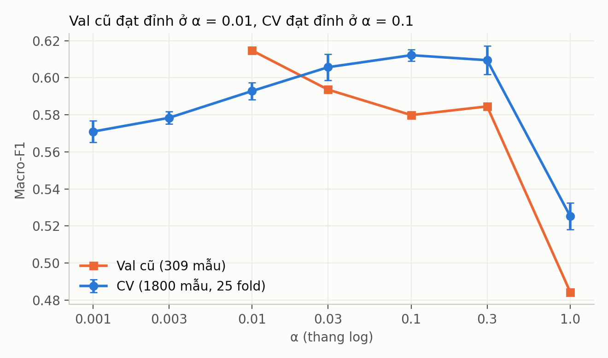
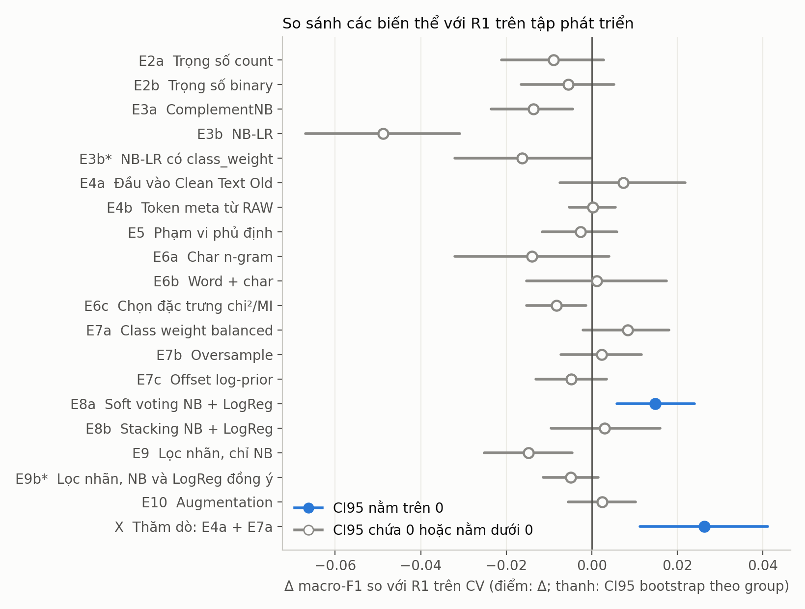
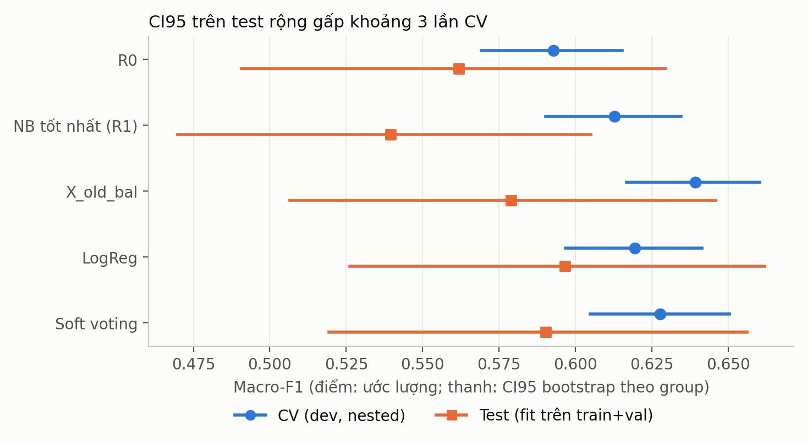
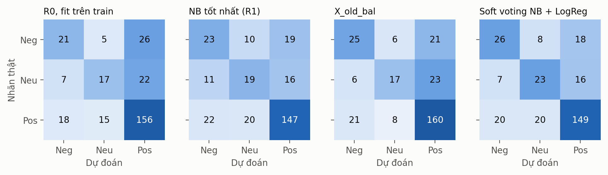
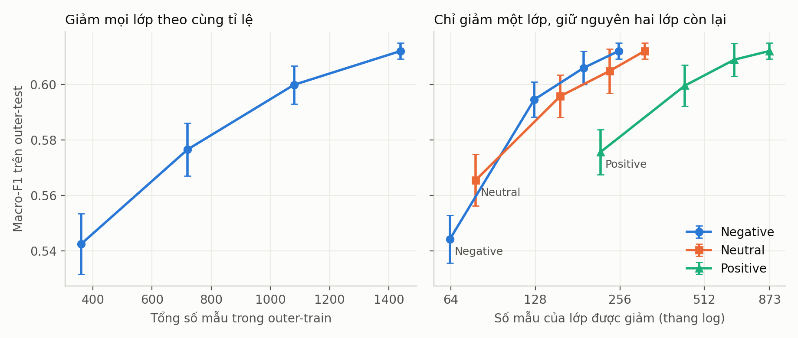

<!-- Tệp này được sinh tự động bởi models/Naive_Bayes/reports/build_report.py từ artifact. Sửa template trong reports/templates/, không sửa trực tiếp. -->

# Báo cáo cải thiện mô hình Naive Bayes: phân tích cảm xúc bình luận phim "Mưa đỏ"

Môn PTKPDLVB, nhánh mô hình, phần Naive Bayes. Ngày chạy thí nghiệm: 2026-11-05.

**Quy ước nhãn bằng chứng:** **VERIFIED** (đọc từ artifact hoặc nguồn gốc), **INFERRED** (suy luận, có nêu lý lẽ), **PROPOSED/SPECULATIVE** (đề xuất hoặc phỏng đoán), **UNKNOWN** (chưa biết).

## Mục lục

- [1. Tóm tắt](#1-tóm-tắt)
- [2. Bài toán, dữ liệu và chống leakage](#2-bài-toán-dữ-liệu-và-chống-leakage)
- [3. Cơ sở lý thuyết Naive Bayes](#3-cơ-sở-lý-thuyết-naive-bayes)
- [4. Baseline và phân tích lỗi](#4-baseline-và-phân-tích-lỗi)
- [5. Các cải tiến đã thử](#5-các-cải-tiến-đã-thử)
- [6. So sánh cuối cùng trên test](#6-so-sánh-cuối-cùng-trên-test)
- [7. Thảo luận](#7-thảo-luận)
- [8. Kế hoạch thu thập dữ liệu](#8-kế-hoạch-thu-thập-dữ-liệu)
- [9. Tái lập](#9-tái-lập)
- [10. Tài liệu tham khảo](#10-tài-liệu-tham-khảo)

## 1. Tóm tắt

**Kết luận ngắn:** các cải tiến chỉ trong họ Naive Bayes **chưa được chứng minh là tốt hơn baseline trên test**. Cải thiện duy nhất có ý nghĩa thống kê trên test đến từ việc **kết hợp NB với LogReg**. Macro-F1 test có CI95 bán kính khoảng 0.070, nên test 287 mẫu chỉ phát hiện được chênh lệch khá lớn.

**Kết quả chính (macro-F1, test 287 mẫu, 271 group, CI95 bootstrap theo group):**

| Mô hình | Macro-F1 test | Macro-F1 CV | Ghi chú |
|---|---|---|---|
| R0 fit trên train | 0.5440 | | Baseline lịch sử, tái lập đúng |
| R0 fit lại trên train+val | 0.5618 | 0.5928 | Đối chứng công bằng cho các mô hình sau |
| NB tốt nhất theo quy tắc (R1) | 0.5395 | 0.6128 | Không tốt hơn R0 trên test |
| `X_old_bal` (thăm dò) | 0.5789 | 0.6391 | Điểm NB cao nhất cả CV lẫn test, chưa có ý nghĩa |
| LogReg | 0.5966 | 0.6193 | Tham chiếu |
| Soft voting NB + LogReg | 0.5902 | 0.6277 | Tốt hơn NB có ý nghĩa |

*Nguồn: `models/Naive_Bayes/experiments/final_test_results.csv`, `results_cv.csv`.*

**Phát hiện chính:**

1. **VERIFIED:** Tune bằng nested CV chọn $\alpha\approx0.1$ thay vì 0.01, tăng macro-F1 CV thêm +0.0200 (CI95 [+0.0079, +0.0327]). Mức tăng này **không lặp lại trên test** ($\Delta$ = -0.0224, CI95 [-0.0699, +0.0264]). CI đó vẫn chứa mức tăng trên CV, nên test không bác bỏ mà cũng không xác nhận.
2. **VERIFIED:** Trong E2–E7, không biến thể nào đạt quy tắc chấp nhận. ComplementNB, NB-LR và chọn đặc trưng còn kém R1 có ý nghĩa trên CV.
3. **VERIFIED:** Soft voting NB + LogReg được chấp nhận trên CV (+0.0149, CI95 [+0.0059, +0.0240]) và là so sánh duy nhất có ý nghĩa sau Holm trên test (+0.0507, CI95 [+0.0144, +0.0904], $p_{\text{Holm}}$ = 0.026).
4. **INFERRED:** Nút thắt nằm nhiều ở dữ liệu, vì hàng loạt thay đổi mô hình không tạo khác biệt trong khi learning curve còn tăng. **VERIFIED:** giảm mẫu Negative làm điểm tụt nhanh nhất, và cleaning đã xóa dấu câu, chữ số, tiểu từ câu hỏi.
5. **Vấn đề hợp lệ chưa giải quyết (INFERRED):** chỉ 11/1800 bình luận dev nhắc "Mưa đỏ", trong khi 52 bình luận nhắc "TBN"/"trại buôn". Nguồn thu thập cần được nhóm xác nhận (mục 2.4).

## 2. Bài toán, dữ liệu và chống leakage

### 2.1 Bài toán

Phân loại mỗi bình luận vào 3 lớp Negative, Neutral, Positive. Chỉ số chính là **macro-F1** vì Positive chiếm khoảng 61%. Accuracy chỉ để tham khảo: mô hình luôn đoán Positive đã đạt accuracy cao nhưng macro-F1 test chỉ 0.2647.

### 2.2 Dữ liệu và split

Nguồn: `Data/final_labeled_clean_v3.xlsx`, 2087 dòng, cột `Comment ID`, `RAW Text`, `Clean Text`, `Final Label`, `Clean Text Old`. Có 2019 text khác nhau, 21 nhóm trùng, 68 dòng dư.

Split khóa sẵn tại `models/Naive_Bayes/datasets/splits/`, chia nhóm theo `Clean Text`. Tính nhóm làm stratification chỉ xấp xỉ.

| Tập | Số dòng | Số text khác nhau | Negative | Neutral | Positive |
|---|---|---|---|---|---|
| train | 1491 | 1441 | 259 (17.4%) | 320 (21.5%) | 912 (61.2%) |
| val | 309 | 307 | 58 (18.8%) | 72 (23.3%) | 179 (57.9%) |
| test | 287 | 271 | 52 (18.1%) | 46 (16.0%) | 189 (65.9%) |

*Bảng 1. Phân bố các tập. Nguồn: `models/Naive_Bayes/datasets/splits/*.csv`.*

**VERIFIED:** Tỉ lệ Neutral lệch rõ giữa val và test, nên test có ít mẫu Neutral hơn dự kiến và F1 Neutral trên test rất nhiễu. Test có 271 text khác nhau trên 287 dòng, gồm một nhóm 11 dòng giống hệt.

### 2.3 Biện pháp chống leakage

- **VERIFIED:** Hash SHA-256 của split và xlsx được kiểm tra ở đầu mỗi notebook (`experiment_plan.md`, mục 1).
- **VERIFIED:** `naive_bayes_improvement.ipynb` không đọc nội dung `test.csv`, và lọc xlsx theo ID dev ngay khi nạp.
- **VERIFIED:** Vocabulary, IDF, chọn đặc trưng, lọc nhãn, oversample đều fit lại trên phần train của từng fold.
- **VERIFIED:** Không có group nào lẫn qua outer hoặc inner fold (kiểm tra bằng `assert`). Không có text trùng sau chuẩn hóa giữa các split; lọc thô bằng Jaccard trên 5-gram ký tự tìm thấy 2 cặp gần trùng train–val và 0 cặp train–test.
- **VERIFIED:** Không dùng `Data/vectorized/vectorized_data.joblib` vì `src/vectorization.py:57` fit TF-IDF trên toàn bộ dữ liệu.
- **Công bố:** điểm test của 4 mô hình đã có trong `comparison_val_test.csv` trước đợt này, nên lần chấm cuối **không phải lần đầu** test được nhìn.

**Rủi ro vận hành:** ô 3 của `naive_bayes_pytorch.ipynb` ghi đè `models/Naive_Bayes/datasets/splits/*.csv`, và các file này chưa được git theo dõi. Không nên chạy lại notebook cũ từ đầu.

### 2.4 Vấn đề dữ liệu phát hiện được

**Phạm vi phim (INFERRED, cần nhóm xác nhận).** Đếm trên `RAW Text` của dev (1800 dòng):

| Từ khóa | Số bình luận |
|---|---|
| "mưa đỏ" | 11 |
| "tbn" hoặc "trại buôn" | 52 |
| "lừa đảo", "buôn người", "bị lừa", "campuchia" | 87 |
| "thiên đường máu" | 56 |

*Bảng 2. Từ khóa trong bình luận dev. Nguồn: `experiments/data_quality.json`.*

Nhiều bình luận mô tả lừa đảo, buôn người, thoát khỏi trại, trong khi theo hiểu biết chung "Mưa đỏ" là phim về trận Thành cổ Quảng Trị. "TBN" nhiều khả năng là viết tắt của một phim khác được nhắc cùng cụm "phim trại buôn". Phần lớn bình luận không nêu tên phim nên không xác định được. Dữ liệu không có ID bài đăng, nên **nguồn thực tế là UNKNOWN**. Nếu dữ liệu chủ yếu về phim khác, tên đề tài cần được điều chỉnh.

**Tác động của cleaning (VERIFIED trên train).** Pipeline tạo `Clean Text` không có trong repo (`src/preprocessing.py` nằm trong `.gitignore`), nên **UNKNOWN** về chi tiết. Từ dữ liệu quan sát được:

- Dấu `?` và `!`, emoji, chữ số, và các từ như `nhưng`, `là`, `mà`, `thì`, `nha`, `vậy` đều bị xóa.
- Teencode phủ định được chuẩn hóa tốt: nhóm `ko/k/kg…` giảm từ 368 xuống 10 bình luận.
- `RAW Text` có 58 bình luận chứa `?`, với $P(\text{Neutral}\mid ?)$ = 0.41 so với nền 0.215. Mẫu điểm thấp có 20 bình luận với $P(\text{Negative})$ = 0.65. Mẫu "10 điểm" có 11 bình luận với $P(\text{Positive})$ = 1.00.
- Một nhóm trùng mâu thuẫn **do cleaning tạo ra**: "Hay lắm hả chị" (câu hỏi, Neutral) và "Hay lắm chị ơi" (khen, Positive) cùng thành `hay lắm chị`. Nhãn đúng, không nên sửa.
- Có 1 dòng dev với chuỗi giữ chỗ `đánh giá phim`: tên dính chữ khiến cleaning xóa cả nội dung "hay đó".
- Tách từ bị dính qua dấu câu, ví dụ `vãi_phim`, `coi_bày`.

**Quyền riêng tư (VERIFIED).** `RAW Text` chứa tên thật người bình luận và `Clean Text` vẫn lọt tên riêng. Mọi trích dẫn trong báo cáo đã che tên. File xlsx đang được git theo dõi; trạng thái công khai của repo là UNKNOWN.

**Độc lập mẫu (UNKNOWN).** Không có ID thread nên chưa kiểm tra được rò rỉ theo thread. Bình luận cùng thread có thể tương quan, làm điểm CV lạc quan.

## 3. Cơ sở lý thuyết Naive Bayes

### 3.1 Multinomial Naive Bayes

**Ký hiệu:**

| Ký hiệu | Ý nghĩa | Kích thước |
|---|---|---|
| $N$, $V$, $C$ | Số văn bản, số term, số lớp ($C=3$) | vô hướng |
| $\mathbf x_d$ | Vector đặc trưng văn bản $d$, thành phần $x_{dt}\ge0$ | $\mathbb R^{V}$ |
| $y_d$ | Nhãn văn bản $d$ | $\{1,\dots,C\}$ |
| $\pi_c$ | Prior của lớp $c$ | $\mathbb R^{C}$ |
| $\theta_{ct}$ | Xác suất term $t$ trong lớp $c$ | $\mathbb R^{C\times V}$ |
| $\alpha$ | Tham số smoothing | vô hướng |

Theo định lý Bayes, với giả định các term độc lập có điều kiện theo lớp:

$$\hat y=\arg\max_c\Big[\ln\pi_c+\sum_{t=1}^{V}x_{t}\ln\theta_{ct}\Big]$$

- $\ln\pi_c$ là độ phổ biến của lớp. `fit_prior=False` đặt $\pi_c=1/C$, nên mô hình không bị kéo về Positive.
- $\sum_t x_t\ln\theta_{ct}$ cộng bằng chứng từ từng term. Làm việc trong log-space để tránh underflow.

### 3.2 Giả định

Giả định độc lập rõ ràng là sai với ngôn ngữ, vì "không hay" là hai từ phụ thuộc nhau. Thực hành dùng bigram để giảm một phần vấn đề, đổi lại vocabulary lớn hơn và nhiều term hiếm hơn. Bằng chứng trùng lặp từ các term tương quan khiến log-odds bị đếm nhiều lần, nên điểm softmax thường quá tự tin (mục 5.9).

### 3.3 Smoothing và thang đo của $\alpha$

Với $M_c=\sum_t\sum_{d:y_d=c}x_{dt}$ là tổng khối lượng đặc trưng của lớp $c$:

$$\theta_{ct}=\frac{\alpha+\sum_{d:y_d=c}x_{dt}}{\alpha V+M_c}$$

Tỉ lệ $\alpha V/M_c$ cho biết smoothing lấn át dữ liệu đến mức nào. **INFERRED:** Với TF-IDF chuẩn L2, mỗi văn bản chỉ đóng góp khối lượng trung bình 3.82, nên $M_c$ nhỏ hơn count khoảng 6.7 lần. Do đó $\alpha$ trên TF-IDF không cùng thang với $\alpha$ trên count: $\alpha=0.01$ tương đương khoảng 0.07 trên count.

| Lớp | $M_c$ (TF-IDF, train) | $\alpha V/M_c$ khi $\alpha=1$, TF-IDF | $\alpha V/M_c$ khi $\alpha=1$, count |
|---|---|---|---|
| Negative | 1126 | 3.73 | 0.56 |
| Neutral | 1136 | 3.70 | |
| Positive | 3431 | 1.23 | 0.20 |

*Bảng 3. Thang đo của smoothing ($V$ = 4204). Nguồn: `experiments/data_quality.json`.*

**Ví dụ số:** lớp Negative, $\alpha=0.1$, mẫu số là 1547, trong đó riêng $\alpha V$ = 420. Term chưa từng xuất hiện có $\theta$ = 6.47e-05; term có tổng trọng số 2 có $\theta$ = 1.36e-03. Term hiếm vì thế không bị xóa, nhưng cũng không có trọng số cực đoan như khi $\alpha$ quá nhỏ.

Smoothing tác động lên lớp thiểu số mạnh hơn khoảng ba lần so với Positive vì $M_c$ của chúng nhỏ hơn.

### 3.4 Độ phức tạp

Với $Z$ là số phần tử khác 0 của ma trận đặc trưng (huấn luyện) và $Z_e$ của tập đánh giá:

- **Huấn luyện:** $O(Z+CV)$ thời gian. Chỉ cần cộng đặc trưng theo lớp, không lặp.
- **Suy luận:** $O(Z_e C)$ thời gian.
- **Bộ nhớ:** $O(CV)$ cho tham số.

Notebook cũ dùng ma trận dense, $O(NV)$ bộ nhớ. Notebook mới dùng COO trên GPU, nên chạy được char n-gram và 8400 lần fit trong vài giây.

### 3.5 TF-IDF là một xấp xỉ

Mô hình multinomial định nghĩa cho số đếm nguyên. Thay $x_{dt}$ bằng TF-IDF thực làm mất hệ số multinomial và ý nghĩa xác suất, nên softmax chỉ là điểm số đã chuẩn hóa. Công thức vẫn tính được vì chỉ cần $x_{dt}\ge0$. Rennie et al. (2003, mục 4) xem các phép biến đổi TF, IDF và chuẩn hóa độ dài là cách chỉnh dữ liệu cho khớp mô hình, và lưu ý lợi ích của chuẩn hóa độ dài trong phân loại "tinh tế hơn" vì mô hình multinomial vốn xử lý độ dài khá tự nhiên.

### 3.6 ComplementNB

Rennie et al. (2003, mục 3.1) ước lượng từ mọi lớp **trừ** $c$ để giảm "skewed data bias":

$$\tilde\theta_{ct}=\frac{\alpha+\sum_{d:y_d\ne c}x_{dt}}{\alpha V+\sum_{c'\ne c}M_{c'}},\qquad
\hat y=\arg\max_c\Big[\ln\pi_c-\sum_t x_t\ln\tilde\theta_{ct}\Big]$$

Cài đặt ở đây giống `sklearn.naive_bayes.ComplementNB`: **không dùng** số hạng $\ln\pi_c$ khi dự đoán, và đã đối chiếu trùng 100% dự đoán.

### 3.7 NB-SVM và NB-LR

Wang & Manning (2012, mục 2) định nghĩa log-count ratio cho bài toán nhị phân:

$$\mathbf r=\ln\frac{\mathbf p/\lVert\mathbf p\rVert_1}{\mathbf q/\lVert\mathbf q\rVert_1},\quad
\mathbf p=\alpha+\sum_{i:y^{(i)}=1}\mathbf f^{(i)},\quad \mathbf q=\alpha+\sum_{i:y^{(i)}=-1}\mathbf f^{(i)}$$

Đặc trưng là $\mathbf r\circ\hat{\mathbf f}$ với $\hat{\mathbf f}$ binary. Bài báo dùng $\alpha=1$, $C=1$, $\beta=0.25$ cho phép nội suy trọng số, và ghi rằng dùng logistic regression thay SVM cho kết quả tương tự. Ở đây dùng one-vs-rest với LogReg, **không dùng** phép nội suy $\beta$.

## 4. Baseline và phân tích lỗi

### 4.1 Baseline

**R0:** word (1,2), `min_df=2`, TF-IDF sublinear chuẩn L2, MNB, $\alpha=0.01$, `fit_prior=False`. Code mới tái lập đúng macro-F1 val 0.6147 và test 0.5440. **VERIFIED** trong ô kiểm tra của cả hai notebook.

Kết quả tham chiếu fit lại trên **cùng fold** (script tạo `comparison_val_test.csv` không có trong repo nên không dùng lại):

| Mô hình | Macro-F1 (mean ± std) | CI95 bootstrap | F1 Negative | F1 Neutral | F1 Positive | Accuracy |
|---|---|---|---|---|---|---|
| Majority | 0.2516 ± 0.0000 | [0.2449, 0.2583] | 0.000 | 0.000 | 0.755 | 0.606 |
| R0: NB hiện tại, cố định | 0.5928 ± 0.0046 | [0.5691, 0.6153] | 0.516 | 0.470 | 0.792 | 0.677 |
| LinearSVC $C=1$, cố định | 0.5826 ± 0.0049 | [0.5583, 0.6056] | 0.491 | 0.453 | 0.804 | 0.690 |
| LogReg $C=3$, cố định | 0.5690 ± 0.0037 | [0.5439, 0.5932] | 0.457 | 0.448 | 0.802 | 0.692 |
| LinearSVC, tune nested | 0.6008 ± 0.0091 | [0.5783, 0.6224] | 0.517 | 0.484 | 0.801 | 0.688 |
| R1: NB, tune nested | 0.6128 ± 0.0065 | [0.5902, 0.6345] | 0.552 | 0.494 | 0.792 | 0.683 |
| LogReg, tune nested | 0.6193 ± 0.0053 | [0.5968, 0.6413] | 0.544 | 0.525 | 0.790 | 0.682 |

*Bảng 4. Đối chứng trên CV: dev 1800 mẫu, 5 lần lặp × 5 fold, nested. CI95 bootstrap theo group. Nguồn: `experiments/results_cv.csv`.*

**VERIFIED:** Trên CV, R0 (0.5928) cao hơn LogReg $C=3$ (0.5690) và LinearSVC $C=1$ (0.5826) cố định, trái với thứ tự trên test cũ (0.5440 so với 0.5884 và 0.5731). Ví dụ này cho thấy thứ hạng trên một tập nhỏ không đáng tin.

### 4.2 $\alpha$ đã overfit val

| $\alpha$ | Macro-F1 CV (mean ± std, 5 lần lặp) | Macro-F1 val (lưới cũ, 309 mẫu) |
|---|---|---|
| 0.001 | 0.5709 ± 0.0059 | chưa chạy |
| 0.003 | 0.5784 ± 0.0033 | chưa chạy |
| 0.01 | 0.5928 ± 0.0046 | 0.6147 |
| 0.03 | 0.6057 ± 0.0071 | 0.5936 |
| 0.1 | 0.6122 ± 0.0031 | 0.5799 |
| 0.3 | 0.6095 ± 0.0077 | 0.5845 |
| 1.0 | 0.5252 ± 0.0072 | 0.4843 |

*Bảng 5. Độ nhạy theo $\alpha$, cố định word (1,2), `min_df=2`, `fit_prior=False`. Nguồn: `experiments/alpha_sensitivity.csv`.*



*Hình 1. Val cũ và CV chọn $\alpha$ khác nhau. Thanh sai số là std qua 5 lần lặp.*

**VERIFIED:** Hình 1 và Bảng 5 cho thấy val đặt đỉnh ở $\alpha=0.01$ (0.6147), trong khi CV đạt đỉnh ở $\alpha=0.1$ (0.6122) và $\alpha=0.01$ chỉ đạt 0.5928. Ở $\alpha=1$ cả hai đều giảm mạnh, phù hợp với mục 3.3.

**Đính chính:** ở giai đoạn lập kế hoạch, người viết đã nhận định "chưa được ủng hộ" với giả thuyết $\alpha$ quá nhỏ, dựa trên xu hướng giảm đều của lưới val. Kết quả CV cho thấy nhận định đó sai: xu hướng ấy là đặc thù của 309 mẫu val.

### 4.3 Phân tích lỗi trên dev

Ma trận nhầm lẫn OOF của R1 (lần lặp đầu):

| Nhãn thật \ Dự đoán | Negative | Neutral | Positive |
|---|---|---|---|
| Negative | 179 | 47 | 91 |
| Neutral | 74 | 183 | 135 |
| Positive | 104 | 124 | 863 |

*Bảng 6. Nguồn: `experiments/confusion_R1_oof_r0.csv`.*

Đọc tay 30 mẫu sai, 5 mẫu cho mỗi cặp nhầm lẫn, chọn ngẫu nhiên với seed cố định. Mỗi mẫu gán một nguyên nhân chính. Phân loại do một mình trợ lý AI thực hiện, chưa có người thứ hai kiểm tra, nên đây là **INFERRED** và chỉ mang tính định hướng.

| Nguyên nhân | Số mẫu | Tỉ lệ | Ví dụ (ghi chú đọc tay) |
|---|---|---|---|
| Nhãn mơ hồ hoặc có thể sai | 6 | 20% | 'cấn cấn' có thể là Negative |
| Khen chê lẫn lộn | 5 | 17% | Vừa 'hay' vừa 'hụt hẫng' |
| Thiếu ngữ cảnh hội thoại | 4 | 13% | 'Tiếc nhỉ' phụ thuộc bình luận trước |
| So sánh với phim khác | 4 | 13% | Khuyên xem phim khác 'hay hơn' |
| Ngắn hoặc ít tín hiệu | 3 | 10% | Câu hỏi ngắn có từ hiếm 'lào' |
| Tranh luận với người khác, đối tượng không phải phim | 3 | 10% | Tranh luận về sự thật, không đánh giá phim |
| Ẩn ý hoặc mỉa mai | 2 | 7% | So thời gian xem phim với chơi game, chê ngầm |
| Phủ định | 2 | 7% | 'ko ăn thua' là thành ngữ phủ định |
| Ngoài chủ đề | 1 | 3% | Lời cảm ơn, có 'cám ơn' gần lớp Positive |

*Bảng 7. Nguyên nhân lỗi. Nguồn: `experiments/error_analysis_labeled.csv`.*

**INFERRED:** Nhiều lỗi nằm ở thứ mà bag-of-n-grams khó biểu diễn:

- **Đối tượng cảm xúc:** bình luận mắng người chê phim thực ra đang bênh phim, nhưng các từ `chê`, `dở` kéo về Negative.
- **So sánh:** `thiên đường máu hay nhưng không bằng phim này` chứa từ khen cho phim khác.
- **Ngữ cảnh hội thoại:** câu trả lời ngắn chỉ có nghĩa khi biết bình luận trước.
- **Nhãn mơ hồ:** ý định đi xem hoặc đồng tình với người khác đang được gán không nhất quán.

Từ `không` xuất hiện ở 41.7% Negative, 38.4% Neutral, 24.7% Positive trên train, có thể vì vừa là phủ định vừa là đuôi câu hỏi. Tuy nhiên chỉ một phần nhỏ lỗi đọc tay là do phủ định, phù hợp với kết quả E5.

## 5. Các cải tiến đã thử

### 5.0 Thiết kế đánh giá

Thiết kế được khóa trước khi chạy tại `models/Naive_Bayes/experiment_plan.md`, các sai lệch ghi ở mục 7 của file đó.

- **Dev:** train + val, 1800 dòng, 1748 group.
- **Outer CV:** `StratifiedGroupKFold` 5 fold, 5 lần lặp (seed 0–4). **Inner CV:** 3 fold.
- **NB tất định:** seed chỉ có tác dụng qua cách chia fold, nên std trong bảng phản ánh việc chia fold, không phải bất định tổng quát hóa.
- **Bất định:** bootstrap 5000 lần theo group `Clean Text`, dùng chung trọng số cho mọi cặp so sánh.
- **Quy tắc chấp nhận:** cận dưới CI95 của $\Delta$ > 0. p Holm được ghi kèm, không thay đổi quy tắc.
- **Đối chứng:** E2–E7 so với R1 để mọi biến thể được tune như nhau trên cùng lưới G (84 cấu hình).

**Kiểm tra đúng đắn (VERIFIED):** TF-IDF lệch sklearn $\sim10^{-16}$; MNB và ComplementNB trùng sklearn 100% dự đoán; bootstrap khớp bản naive; chi² đối chiếu bằng scipy. Xem ô 7 của `naive_bayes_improvement.ipynb`.

### 5.1 Bảng tổng hợp

| ID | Biến thể | Macro-F1 CV (mean ± std) | F1 Neg / Neu / Pos | $\Delta$ | CI95 của $\Delta$ | p | p Holm | Quyết định |
|---|---|---|---|---|---|---|---|---|
| E1 | Tune nested so với cố định | 0.6128 ± 0.0065 | 0.552 / 0.494 / 0.792 | +0.0200 | [+0.0079, +0.0327] | 0.002 | 0.037 | Chấp nhận |
| E2a | Trọng số count | 0.6039 ± 0.0108 | 0.534 / 0.489 / 0.789 | -0.0089 | [-0.0211, +0.0028] | 0.137 | 1.000 | Không đủ bằng chứng |
| E2b | Trọng số binary | 0.6073 ± 0.0094 | 0.542 / 0.490 / 0.790 | -0.0055 | [-0.0165, +0.0052] | 0.314 | 1.000 | Không đủ bằng chứng |
| E3a | ComplementNB | 0.5991 ± 0.0077 | 0.540 / 0.462 / 0.795 | -0.0137 | [-0.0235, -0.0044] | 0.003 | 0.067 | Kém hơn có ý nghĩa |
| E3b | NB-LR | 0.5640 ± 0.0114 | 0.474 / 0.420 / 0.799 | -0.0488 | [-0.0669, -0.0309] | <0.001 | 0.005 | Kém hơn có ý nghĩa |
| E3b* | NB-LR có `class_weight` | 0.5966 ± 0.0077 | 0.513 / 0.494 / 0.782 | -0.0162 | [-0.0321, -0.0004] | 0.046 | 0.742 | Kém hơn có ý nghĩa |
| E4a | Đầu vào `Clean Text Old` | 0.6201 ± 0.0059 | 0.547 / 0.517 / 0.796 | +0.0073 | [-0.0075, +0.0219] | 0.327 | 1.000 | Không đủ bằng chứng |
| E4b | Token meta từ RAW | 0.6130 ± 0.0063 | 0.553 / 0.491 / 0.796 | +0.0002 | [-0.0052, +0.0056] | 0.958 | 1.000 | Không đủ bằng chứng |
| E5 | Phạm vi phủ định | 0.6102 ± 0.0060 | 0.549 / 0.491 / 0.790 | -0.0026 | [-0.0116, +0.0058] | 0.537 | 1.000 | Không đủ bằng chứng |
| E6a | Char n-gram | 0.5989 ± 0.0045 | 0.537 / 0.489 / 0.770 | -0.0140 | [-0.0320, +0.0040] | 0.124 | 1.000 | Không đủ bằng chứng |
| E6b | Word + char | 0.6140 ± 0.0041 | 0.549 / 0.499 / 0.794 | +0.0012 | [-0.0152, +0.0175] | 0.882 | 1.000 | Không đủ bằng chứng |
| E6c | Chọn đặc trưng chi²/MI | 0.6046 ± 0.0042 | 0.541 / 0.484 / 0.789 | -0.0082 | [-0.0152, -0.0013] | 0.020 | 0.360 | Kém hơn có ý nghĩa |
| E7a | Class weight balanced | 0.6212 ± 0.0107 | 0.565 / 0.511 / 0.787 | +0.0084 | [-0.0020, +0.0181] | 0.120 | 1.000 | Không đủ bằng chứng |
| E7b | Oversample | 0.6152 ± 0.0064 | 0.562 / 0.497 / 0.786 | +0.0024 | [-0.0072, +0.0117] | 0.630 | 1.000 | Không đủ bằng chứng |
| E7c | Offset log-prior | 0.6079 ± 0.0054 | 0.545 / 0.492 / 0.786 | -0.0049 | [-0.0130, +0.0034] | 0.246 | 1.000 | Không đủ bằng chứng |
| E8a | Soft voting NB + LogReg | 0.6277 ± 0.0081 | 0.567 / 0.515 / 0.801 | +0.0149 | [+0.0059, +0.0240] | 0.002 | 0.044 | Chấp nhận |
| E8b | Stacking NB + LogReg | 0.6157 ± 0.0067 | 0.560 / 0.522 / 0.765 | +0.0029 | [-0.0096, +0.0159] | 0.654 | 1.000 | Không đủ bằng chứng |
| E9 | Lọc nhãn, chỉ NB | 0.5980 ± 0.0096 | 0.536 / 0.466 / 0.792 | -0.0148 | [-0.0251, -0.0046] | 0.003 | 0.067 | Kém hơn có ý nghĩa |
| E9b* | Lọc nhãn, NB và LogReg đồng ý | 0.6079 ± 0.0108 | 0.542 / 0.487 / 0.795 | -0.0049 | [-0.0113, +0.0016] | 0.132 | 1.000 | Không đủ bằng chứng |
| E10 | Augmentation | 0.6152 ± 0.0093 | 0.557 / 0.492 / 0.796 | +0.0024 | [-0.0055, +0.0102] | 0.536 | 1.000 | Không đủ bằng chứng |
| X | Thăm dò: E4a + E7a | 0.6391 ± 0.0047 | 0.579 / 0.547 / 0.792 | +0.0263 | [+0.0113, +0.0411] | <0.001 | 0.010 | Chấp nhận |

*Bảng 8. Tất cả thí nghiệm trên CV: 5 lần lặp, 25 fold, bootstrap 5000 lần. $\Delta$ so với R1, riêng E1 so với R0. \* là post-hoc, ngoài bản đăng ký. Nguồn: `experiments/results_cv.csv`, `experiments/comparisons_cv.csv`.*



*Hình 2. $\Delta$ macro-F1 so với R1 trên CV. Điểm đặc là các biến thể có CI95 nằm trên 0.*

Hình 2 cho thấy hầu hết các thay đổi dao động quanh 0. Chỉ soft voting và cấu hình thăm dò có CI95 nằm trên 0.

### 5.2 E1: Tune bằng nested CV

- **Mục tiêu:** chọn hyperparameter ổn định hơn so với val 309 mẫu.
- **Giả thuyết:** quy trình tune nested tốt hơn cấu hình cố định R0 trên fold ngoài.
- **Thay đổi:** lưới G gồm $\alpha$ từ 0.001 đến 1, `min_df`, bậc n-gram, `fit_prior`.

| ID | Biến thể | Macro-F1 CV (mean ± std) | F1 Neg / Neu / Pos | $\Delta$ | CI95 của $\Delta$ | p | p Holm | Quyết định |
|---|---|---|---|---|---|---|---|---|
| E1 | Tune nested so với cố định | 0.6128 ± 0.0065 | 0.552 / 0.494 / 0.792 | +0.0200 | [+0.0079, +0.0327] | 0.002 | 0.037 | Chấp nhận |

- **Kết luận:** chấp nhận trên CV. Trong 25 outer fold, $\alpha=0.1$ được chọn 12 lần, $\alpha=0.3$ 11 lần, $\alpha=0.03$ 2 lần. `fit_prior=False` luôn được chọn.

### 5.3 E2: Trọng số đặc trưng

- **Mục tiêu:** kiểm tra TF-IDF có thực sự cần thiết cho MNB.
- **Giả thuyết:** count (E2a) hoặc binary (E2b) tốt hơn TF-IDF L2.

| ID | Biến thể | Macro-F1 CV (mean ± std) | F1 Neg / Neu / Pos | $\Delta$ | CI95 của $\Delta$ | p | p Holm | Quyết định |
|---|---|---|---|---|---|---|---|---|
| E2a | Trọng số count | 0.6039 ± 0.0108 | 0.534 / 0.489 / 0.789 | -0.0089 | [-0.0211, +0.0028] | 0.137 | 1.000 | Không đủ bằng chứng |

| ID | Biến thể | Macro-F1 CV (mean ± std) | F1 Neg / Neu / Pos | $\Delta$ | CI95 của $\Delta$ | p | p Holm | Quyết định |
|---|---|---|---|---|---|---|---|---|
| E2b | Trọng số binary | 0.6073 ± 0.0094 | 0.542 / 0.490 / 0.790 | -0.0055 | [-0.0165, +0.0052] | 0.314 | 1.000 | Không đủ bằng chứng |

- **Kết luận:** không đủ bằng chứng. Khác với kết quả của Wang & Manning (2012) trên tiếng Anh, binary không tốt hơn ở đây.

### 5.4 E3: Biến thể NB

- **Mục tiêu:** giảm sai lệch do dữ liệu lệch lớp (CNB), kết hợp sinh và phân biệt (NB-LR).
- **Giả thuyết:** CNB hoặc NB-LR tốt hơn MNB.

| ID | Biến thể | Macro-F1 CV (mean ± std) | F1 Neg / Neu / Pos | $\Delta$ | CI95 của $\Delta$ | p | p Holm | Quyết định |
|---|---|---|---|---|---|---|---|---|
| E3a | ComplementNB | 0.5991 ± 0.0077 | 0.540 / 0.462 / 0.795 | -0.0137 | [-0.0235, -0.0044] | 0.003 | 0.067 | Kém hơn có ý nghĩa |

| ID | Biến thể | Macro-F1 CV (mean ± std) | F1 Neg / Neu / Pos | $\Delta$ | CI95 của $\Delta$ | p | p Holm | Quyết định |
|---|---|---|---|---|---|---|---|---|
| E3b | NB-LR | 0.5640 ± 0.0114 | 0.474 / 0.420 / 0.799 | -0.0488 | [-0.0669, -0.0309] | <0.001 | 0.005 | Kém hơn có ý nghĩa |

| ID | Biến thể | Macro-F1 CV (mean ± std) | F1 Neg / Neu / Pos | $\Delta$ | CI95 của $\Delta$ | p | p Holm | Quyết định |
|---|---|---|---|---|---|---|---|---|
| E3b* | NB-LR có `class_weight` | 0.5966 ± 0.0077 | 0.513 / 0.494 / 0.782 | -0.0162 | [-0.0321, -0.0004] | 0.046 | 0.742 | Kém hơn có ý nghĩa |

- **Kết luận:** bác bỏ cả hai trong dữ liệu này. Dữ liệu lệch lớp đã được xử lý phần nào bằng `fit_prior=False`. E3b* là post-hoc vì E3b không có `class_weight` trong lưới; bổ sung làm điểm tăng nhiều nhưng vẫn thấp hơn R1.

### 5.5 E4: Đầu vào văn bản

- **Mục tiêu:** khôi phục tín hiệu mà cleaning đã xóa.
- **Giả thuyết:** `Clean Text Old` (E4a) hoặc token meta từ RAW (E4b) tăng macro-F1.
- **Thay đổi:** E4a thay đầu vào. Đây là so sánh trọn gói vì `Old` khác ở nhiều điểm: giữ `nhưng` (153 bình luận train), chữ số, token emoji. E4b thêm 4 token cho `?`, `!`, điểm cao, điểm thấp. Nguyên văn RAW không vào đặc trưng vì có tên thật.

| ID | Biến thể | Macro-F1 CV (mean ± std) | F1 Neg / Neu / Pos | $\Delta$ | CI95 của $\Delta$ | p | p Holm | Quyết định |
|---|---|---|---|---|---|---|---|---|
| E4a | Đầu vào `Clean Text Old` | 0.6201 ± 0.0059 | 0.547 / 0.517 / 0.796 | +0.0073 | [-0.0075, +0.0219] | 0.327 | 1.000 | Không đủ bằng chứng |

| ID | Biến thể | Macro-F1 CV (mean ± std) | F1 Neg / Neu / Pos | $\Delta$ | CI95 của $\Delta$ | p | p Holm | Quyết định |
|---|---|---|---|---|---|---|---|---|
| E4b | Token meta từ RAW | 0.6130 ± 0.0063 | 0.553 / 0.491 / 0.796 | +0.0002 | [-0.0052, +0.0056] | 0.958 | 1.000 | Không đủ bằng chứng |

- **Kết luận:** không đủ bằng chứng. Độ phủ của token meta quá nhỏ để tạo khác biệt.

### 5.6 E5: Phạm vi phủ định

- **Mục tiêu:** phân biệt `không hay` với `hay`.
- **Giả thuyết:** gắn `not_` cho $k$ token sau từ phủ định, $k\in\{1,2,3\}$ tune nested, tốt hơn bigram thuần.

| ID | Biến thể | Macro-F1 CV (mean ± std) | F1 Neg / Neu / Pos | $\Delta$ | CI95 của $\Delta$ | p | p Holm | Quyết định |
|---|---|---|---|---|---|---|---|---|
| E5 | Phạm vi phủ định | 0.6102 ± 0.0060 | 0.549 / 0.491 / 0.790 | -0.0026 | [-0.0116, +0.0058] | 0.537 | 1.000 | Không đủ bằng chứng |

- **Kết luận:** không đủ bằng chứng. **INFERRED:** bigram đã bắt được phần lớn, và không có dấu câu để xác định phạm vi.

### 5.7 E6: Đặc trưng ký tự và chọn đặc trưng

- **Mục tiêu:** chịu lỗi chính tả, giảm n-gram hiếm.
- **Giả thuyết:** char n-gram (E6a), hợp word + char (E6b), hoặc chọn đặc trưng chi²/MI (E6c) tốt hơn word n-gram.

| ID | Biến thể | Macro-F1 CV (mean ± std) | F1 Neg / Neu / Pos | $\Delta$ | CI95 của $\Delta$ | p | p Holm | Quyết định |
|---|---|---|---|---|---|---|---|---|
| E6a | Char n-gram | 0.5989 ± 0.0045 | 0.537 / 0.489 / 0.770 | -0.0140 | [-0.0320, +0.0040] | 0.124 | 1.000 | Không đủ bằng chứng |

| ID | Biến thể | Macro-F1 CV (mean ± std) | F1 Neg / Neu / Pos | $\Delta$ | CI95 của $\Delta$ | p | p Holm | Quyết định |
|---|---|---|---|---|---|---|---|---|
| E6b | Word + char | 0.6140 ± 0.0041 | 0.549 / 0.499 / 0.794 | +0.0012 | [-0.0152, +0.0175] | 0.882 | 1.000 | Không đủ bằng chứng |

| ID | Biến thể | Macro-F1 CV (mean ± std) | F1 Neg / Neu / Pos | $\Delta$ | CI95 của $\Delta$ | p | p Holm | Quyết định |
|---|---|---|---|---|---|---|---|---|
| E6c | Chọn đặc trưng chi²/MI | 0.6046 ± 0.0042 | 0.541 / 0.484 / 0.789 | -0.0082 | [-0.0152, -0.0013] | 0.020 | 0.360 | Kém hơn có ý nghĩa |

- **Kết luận:** không đạt. Teencode đã được cleaning chuẩn hóa nên lợi thế của char n-gram nhỏ. Chọn đặc trưng còn làm giảm điểm, phù hợp với việc $\alpha$ lớn hơn đã kiểm soát term hiếm.

### 5.8 E7: Cân bằng lớp

- **Mục tiêu:** tăng recall lớp thiểu số.
- **Giả thuyết:** class weight (E7a), oversample (E7b), hoặc offset log-prior (E7c) tăng macro-F1.

| ID | Biến thể | Macro-F1 CV (mean ± std) | F1 Neg / Neu / Pos | $\Delta$ | CI95 của $\Delta$ | p | p Holm | Quyết định |
|---|---|---|---|---|---|---|---|---|
| E7a | Class weight balanced | 0.6212 ± 0.0107 | 0.565 / 0.511 / 0.787 | +0.0084 | [-0.0020, +0.0181] | 0.120 | 1.000 | Không đủ bằng chứng |

| ID | Biến thể | Macro-F1 CV (mean ± std) | F1 Neg / Neu / Pos | $\Delta$ | CI95 của $\Delta$ | p | p Holm | Quyết định |
|---|---|---|---|---|---|---|---|---|
| E7b | Oversample | 0.6152 ± 0.0064 | 0.562 / 0.497 / 0.786 | +0.0024 | [-0.0072, +0.0117] | 0.630 | 1.000 | Không đủ bằng chứng |

| ID | Biến thể | Macro-F1 CV (mean ± std) | F1 Neg / Neu / Pos | $\Delta$ | CI95 của $\Delta$ | p | p Holm | Quyết định |
|---|---|---|---|---|---|---|---|---|
| E7c | Offset log-prior | 0.6079 ± 0.0054 | 0.545 / 0.492 / 0.786 | -0.0049 | [-0.0130, +0.0034] | 0.246 | 1.000 | Không đủ bằng chứng |

- **Kết luận:** không đủ bằng chứng. E7a có $\Delta$ điểm dương lớn nhất nhưng CI95 chứa 0.

### 5.9 E9: Nhãn nghi nhiễu

Thí nghiệm này tách khỏi thí nghiệm mô hình. Điểm luôn tính trên **nhãn gốc**, nên có thể đánh giá thấp lợi ích của việc làm sạch nhãn.

- **Giả thuyết:** bỏ nhãn nghi nhiễu trong outer-train giúp tăng macro-F1.
- **E9 (đã đăng ký):** bỏ dòng khi NB (R0) đoán khác nhãn với độ tin cậy $>0.7$. Trung bình 220 dòng mỗi fold (15% outer-train), khoảng 197–251.
- **E9b\* (post-hoc):** chỉ bỏ khi cả NB và LogReg cùng đồng ý. Trung bình 40 dòng (2.8%), khoảng 26–57.

| ID | Biến thể | Macro-F1 CV (mean ± std) | F1 Neg / Neu / Pos | $\Delta$ | CI95 của $\Delta$ | p | p Holm | Quyết định |
|---|---|---|---|---|---|---|---|---|
| E9 | Lọc nhãn, chỉ NB | 0.5980 ± 0.0096 | 0.536 / 0.466 / 0.792 | -0.0148 | [-0.0251, -0.0046] | 0.003 | 0.067 | Kém hơn có ý nghĩa |

| ID | Biến thể | Macro-F1 CV (mean ± std) | F1 Neg / Neu / Pos | $\Delta$ | CI95 của $\Delta$ | p | p Holm | Quyết định |
|---|---|---|---|---|---|---|---|---|
| E9b* | Lọc nhãn, NB và LogReg đồng ý | 0.6079 ± 0.0108 | 0.542 / 0.487 / 0.795 | -0.0049 | [-0.0113, +0.0016] | 0.132 | 1.000 | Không đủ bằng chứng |

- **Kết luận:** không có lợi. E9 gây hại vì NB với $\alpha=0.01$ quá tự tin nên lọc mất nhiều mẫu lớp thiểu số hợp lệ. E9b* không có ý nghĩa.

**Không tái lập được con số 37/1491:** OOF 5 fold trên train cho 214 cờ từ NB, 61 cờ từ LogReg, 43 cờ từ cả hai. Quy trình gốc không có artifact (**UNKNOWN**).

**Kiểm toán nhãn:** `models/Naive_Bayes/datasets/label_audit.csv` có 63 dòng train: các mẫu LogReg gắn cờ và nhóm trùng mâu thuẫn train, cộng 2 dòng test chỉ liệt kê. Đề xuất do trợ lý AI đọc tay, là **gán nhãn sơ bộ bằng LLM, không phải ground truth**. Chưa có dòng nào được sửa.

| Split | Đề xuất | Số dòng |
|---|---|---|
| test | chỉ liệt kê - không sửa | 2 |
| train | giữ | 46 |
| train | mơ hồ - nhóm quyết | 9 |
| train | đề xuất sửa | 8 |

*Bảng 9. Tổng hợp đề xuất. Nguồn: `models/Naive_Bayes/datasets/label_audit.csv`.*

| ID | Clean Text (che tên, cắt ngắn) | Nhãn hiện tại | Đề xuất | Nhãn đề xuất | Lý do |
|---|---|---|---|---|---|
| 467 | thiệt mấy cảnh bác chủ_quan xx cắt đi cho cháu xem | Negative | mơ hồ - nhóm quyết | Neutral | Góp ý nên cắt cảnh, không chê phim rõ ràng |
| 2234 | tôi lạy lôi chị làm gì thg áp_bức có giỏi võ_đâu đánh hay | Negative | mơ hồ - nhóm quyết | Neutral | Công kích ý kiến người khác, không đánh giá phim rõ ràng |
| 3172 | chê nhiều tự làm phim xem nói nghe ứa gan | Negative | đề xuất sửa | Positive | Bênh phim, mắng người chê; các dòng cùng kiểu 1692 và 2104 đang là Positive |
| 3016 | cùng suy_nghĩ mình chỉ chấm năm điểm | Neutral | mơ hồ - nhóm quyết | Negative | 'chỉ chấm 5/10' có ý hạ thấp; cần quy tắc cho điểm số |
| 3252 | chấm điểm bạn nhận_xét năm điểm | Neutral | mơ hồ - nhóm quyết | Neutral | 5/10 không kèm từ đánh giá; cần quy tắc cho điểm số |
| 632 | còn tôi đang đợi chiếu để đi coi đuỹ iu dấu | Positive | đề xuất sửa | Neutral | Chỉ nói đang đợi chiếu; dòng cùng kiểu 1665 là Neutral |
| 2330 | em mới xem qua thôi nghe cũng ớn chị | Positive | đề xuất sửa | Neutral | 'nghe cũng ớn', chưa xem kỹ, không có ý khen |
| 2828 | giỏi thiệt chứ nói phát răm_rắp khỏi cần phiên_dịch luôn kiểu kiểu tôi | Positive | mơ hồ - nhóm quyết | Negative | Giọng mỉa mai chi tiết phiên dịch trong phim |
| 2949 | bạn nhận_xét chính_xác | Positive | đề xuất sửa | Neutral | Chỉ đồng ý với người khác; không rõ khen hay chê phim nếu thiếu ngữ cảnh |
| 3130 | rất đúng với mình mình đã tưởng_tượng cảnh bắt lại sau khi chạy thoát  | Positive | đề xuất sửa | Negative | Liệt kê điểm vô lý của kịch bản, 'hết sức vô lý' |
| 3255 | bạn nói giống chị nghĩ trong phim | Positive | đề xuất sửa | Neutral | Đồng tình với người khác, không đánh giá phim |
| 3371 | đang đánh hay nó chuyển qua tình_cảm phim_ổn rồi gáng cho quánh nhau v | Positive | mơ hồ - nhóm quyết | Neutral | Vừa 'phim ổn 80%' vừa chê đoạn tình cảm |
| 3296 | xem như coin card tôi | Negative | mơ hồ - nhóm quyết | Neutral | Nội dung không rõ nghĩa |
| 2240 | đánh đấm_hơi nhiều nhiều cả siro | Neutral | mơ hồ - nhóm quyết | Negative | Chê nhẹ phim nhiều đánh đấm và máu |
| 1613 | để em đi trải_nghiệm cười | Positive | đề xuất sửa | Neutral | Ý định đi xem, không đánh giá |
| 1889 | bạn phải hiểu điều phần_lớn người phải liều_mạng kiếm tiền con mẹ ngườ | Positive | đề xuất sửa | Neutral | Giải thích nội dung cho người khác, không tỏ thái độ |
| 2504 | nó màu y_chang thiên_đường_máu kiểu như quy_mô to hơn tđm nói_chung co | Positive | mơ hồ - nhóm quyết | Neutral | '1 màu' đi kèm 'coi được' |

*Bảng 10. Các dòng cần nhóm duyệt. Nguồn: `models/Naive_Bayes/datasets/label_audit.csv`.*

Thí nghiệm "sửa nhãn" chưa chạy, chờ nhóm duyệt bảng trên. Nhóm mâu thuẫn trong test (ID 347, 414) là cùng một câu do cùng người đăng hai lần nhưng bị gán Neutral và Positive. Hai dòng này chỉ được liệt kê, vì sửa nhãn test sau khi chấm là contamination.

### 5.10 E10: Augmentation

- **Giả thuyết:** thêm bản sao bằng random deletion và random swap cho lớp thiểu số giúp tăng macro-F1. Đây là hai trong bốn phép của EDA (Wei & Zou, 2019).
- **Thay đổi:** 680 bản sao, chỉ tham gia khi văn bản gốc thuộc train của fold, không tính vào `df`/IDF.

| ID | Biến thể | Macro-F1 CV (mean ± std) | F1 Neg / Neu / Pos | $\Delta$ | CI95 của $\Delta$ | p | p Holm | Quyết định |
|---|---|---|---|---|---|---|---|---|
| E10 | Augmentation | 0.6152 ± 0.0093 | 0.557 / 0.492 / 0.796 | +0.0024 | [-0.0055, +0.0102] | 0.536 | 1.000 | Không đủ bằng chứng |

- **Kết luận:** không đủ bằng chứng. Xóa và hoán đổi token không thêm từ vựng mới cho MNB. Augmentation không thay thế dữ liệu thật.

### 5.11 E8: Kết hợp NB với LogReg

- **Mục tiêu:** trả lời "NB có đủ không hay cần kết hợp".
- **Giả thuyết:** ensemble tốt hơn NB thuần.
- **Thay đổi:** E8a soft voting, chọn $w$ trên inner OOF. E8b stacking bằng LogReg meta. Mỗi outer fold dùng đúng cấu hình đã chọn cho fold đó.

| ID | Biến thể | Macro-F1 CV (mean ± std) | F1 Neg / Neu / Pos | $\Delta$ | CI95 của $\Delta$ | p | p Holm | Quyết định |
|---|---|---|---|---|---|---|---|---|
| E8a | Soft voting NB + LogReg | 0.6277 ± 0.0081 | 0.567 / 0.515 / 0.801 | +0.0149 | [+0.0059, +0.0240] | 0.002 | 0.044 | Chấp nhận |

| ID | Biến thể | Macro-F1 CV (mean ± std) | F1 Neg / Neu / Pos | $\Delta$ | CI95 của $\Delta$ | p | p Holm | Quyết định |
|---|---|---|---|---|---|---|---|---|
| E8b | Stacking NB + LogReg | 0.6157 ± 0.0067 | 0.560 / 0.522 / 0.765 | +0.0029 | [-0.0096, +0.0159] | 0.654 | 1.000 | Không đủ bằng chứng |

- **Kết luận:** E8a được chấp nhận. Trong 25 fold, $w=0.25$ được chọn 15 lần, $w=0.5$ 6 lần, $w=0$ 3 lần, $w=0.75$ 1 lần, tức LogReg thường có trọng số lớn hơn. So với `LogReg_tuned`, soft voting tăng +0.0083 (CI95 [+0.0004, +0.0164]), nên NB có đóng góp thật. Stacking không hơn, có thể vì meta-learner có ít dữ liệu.

### 5.12 Quyết định trước khi chấm test

Không biến thể E2–E7 nào được chấp nhận, nên theo bản đăng ký **NB tốt nhất là R1** và không có bước ghép.

**Cấu hình thăm dò `X_old_bal`.** Ghép E4a (+0.0073) và E7a (+0.0084) cho $\Delta$ = +0.0263 (CI95 [+0.0113, +0.0411]) trên CV, lớn hơn tổng hai thành phần. Cặp này được chọn sau khi xem $\Delta$ của các biến thể, nên điểm CV có thể bị thổi phồng. Ban đầu nó được ghi là không vào test. Trước khi mở test, người dùng quyết định thêm nó thành phép so sánh thứ 4, ghi trong Nhật ký sai lệch.

| ID | Biến thể | Macro-F1 CV (mean ± std) | F1 Neg / Neu / Pos | $\Delta$ | CI95 của $\Delta$ | p | p Holm | Quyết định |
|---|---|---|---|---|---|---|---|---|
| X | Thăm dò: E4a + E7a | 0.6391 ± 0.0047 | 0.579 / 0.547 / 0.792 | +0.0263 | [+0.0113, +0.0411] | <0.001 | 0.010 | Chấp nhận |

**Cấu hình khóa cho test** (`experiments/final_candidates.json`, sha256 `96e9fe6eccf85f10…`, chọn bằng macro-F1 gộp trên 25 outer fold):

- **NB tốt nhất:** word (1,2), `min_df`=3, $\alpha$=0.1, `fit_prior=False`.
- **LogReg:** word (1,2), `min_df`=1, $C$=1, `class_weight="balanced"`.
- **Soft voting:** $w$=0.5 cho NB.
- **`X_old_bal`:** `Clean Text Old`, word (1,2), `min_df`=1, $\alpha$=0.1, class weight balanced.

## 6. So sánh cuối cùng trên test

Chấm lúc 2026-11-05 21:52:14 EST trong `naive_bayes_final_test.ipynb`. Mọi mô hình fit trên train+val, trừ dòng lịch sử. Baseline tái lập đúng 0.5440, là tín hiệu rằng quy trình chấm không có lỗi.

| Mô hình | Macro-F1 test | CI95 bootstrap theo group | F1 Negative | F1 Neutral | F1 Positive | Accuracy |
|---|---|---|---|---|---|---|
| R0, fit trên train (lịch sử) | 0.5440 | [0.4723, 0.6127] | 0.429 | 0.410 | 0.794 | 0.676 |
| R0, fit lại trên train+val | 0.5618 | [0.4907, 0.6295] | 0.505 | 0.370 | 0.810 | 0.693 |
| NB tốt nhất theo quy tắc (R1) | 0.5395 | [0.4699, 0.6051] | 0.426 | 0.400 | 0.792 | 0.659 |
| `X_old_bal` (thăm dò) | 0.5789 | [0.5066, 0.6458] | 0.481 | 0.442 | 0.814 | 0.704 |
| LogReg | 0.5966 | [0.5262, 0.6618] | 0.491 | 0.484 | 0.815 | 0.700 |
| Soft voting NB + LogReg | 0.5902 | [0.5194, 0.6561] | 0.495 | 0.474 | 0.801 | 0.690 |

*Bảng 11. Kết quả test, 287 mẫu, 271 group, chấm một lần, CI95 bootstrap theo group 10000 lần. Nguồn: `experiments/final_test_results.csv`.*

| So sánh | $\Delta$ macro-F1 | CI95 của $\Delta$ | p bootstrap | p Holm | Có ý nghĩa sau Holm | A đúng B sai / A sai B đúng | p McNemar (accuracy) |
|---|---|---|---|---|---|---|---|
| NB tốt nhất theo quy tắc (R1) so với R0, fit lại trên train+val | -0.0224 | [-0.0699, +0.0264] | 0.375 | 0.540 | Không | 12 / 22 | 0.121 |
| Soft voting NB + LogReg so với NB tốt nhất theo quy tắc (R1) | +0.0507 | [+0.0144, +0.0904] | 0.007 | 0.026 | Có | 14 / 5 | 0.064 |
| NB tốt nhất theo quy tắc (R1) so với LogReg | -0.0571 | [-0.1217, +0.0088] | 0.091 | 0.274 | Không | 21 / 33 | 0.134 |
| `X_old_bal` (thăm dò) so với NB tốt nhất theo quy tắc (R1) | +0.0394 | [-0.0307, +0.1081] | 0.270 | 0.540 | Không | 34 / 21 | 0.105 |

*Bảng 12. Họ so sánh trên test, 4 phép, Holm. Chỉ số chính là paired bootstrap theo group trên macro-F1. McNemar exact chỉ áp dụng cho accuracy. Nguồn: `experiments/final_test_comparisons.csv`.*

**Diễn giải:**

- **Soft voting so với NB tốt nhất:** +0.0507, CI95 [+0.0144, +0.0904], $p_{\text{Holm}}$ = 0.026. **Có ý nghĩa** trên macro-F1. McNemar cho accuracy không có ý nghĩa ở mức 0.05.
- **NB tốt nhất so với R0 fit lại:** -0.0224, CI95 [-0.0699, +0.0264]. **Không tốt hơn.** Mức tăng +0.0200 trên CV nằm trong CI này, nên test không đủ để xác nhận hay bác bỏ.
- **NB tốt nhất so với LogReg:** -0.0571, CI95 [-0.1217, +0.0088]. Không có ý nghĩa, nhưng hướng cùng với kết quả trước đây.
- **`X_old_bal` so với NB tốt nhất:** +0.0394, CI95 [-0.0307, +0.1081]. Không có ý nghĩa.
- **Thêm dữ liệu:** R0 fit lại trên train+val cao hơn R0 fit trên train +0.0178, là quan sát mô tả, không kiểm định.



*Hình 3. So sánh CV và test. CV là quy trình nested; test là một cấu hình cố định fit trên train+val.*

Hình 3 cho thấy mọi mô hình đều giảm từ CV xuống test, và R1 giảm nhiều nhất. Không nên đọc thứ hạng trên test như kết luận chắc chắn vì các CI chồng lên nhau rộng.

| Mô hình | Lớp | Precision | Recall | F1 | Support |
|---|---|---|---|---|---|
| R0, fit lại trên train+val | Negative | 0.510 | 0.500 | 0.505 | 52 |
| R0, fit lại trên train+val | Neutral | 0.429 | 0.326 | 0.370 | 46 |
| R0, fit lại trên train+val | Positive | 0.786 | 0.836 | 0.810 | 189 |
| NB tốt nhất theo quy tắc (R1) | Negative | 0.411 | 0.442 | 0.426 | 52 |
| NB tốt nhất theo quy tắc (R1) | Neutral | 0.388 | 0.413 | 0.400 | 46 |
| NB tốt nhất theo quy tắc (R1) | Positive | 0.808 | 0.778 | 0.792 | 189 |
| Soft voting NB + LogReg | Negative | 0.491 | 0.500 | 0.495 | 52 |
| Soft voting NB + LogReg | Neutral | 0.451 | 0.500 | 0.474 | 46 |
| Soft voting NB + LogReg | Positive | 0.814 | 0.788 | 0.801 | 189 |
| `X_old_bal` (thăm dò) | Negative | 0.481 | 0.481 | 0.481 | 52 |
| `X_old_bal` (thăm dò) | Neutral | 0.548 | 0.370 | 0.442 | 46 |
| `X_old_bal` (thăm dò) | Positive | 0.784 | 0.847 | 0.814 | 189 |

*Bảng 13. Precision, recall, F1 theo lớp trên test. Nguồn: `experiments/final_test_per_class.csv`.*



*Hình 4. Ma trận nhầm lẫn trên test, màu theo tỉ lệ trong từng hàng. Nguồn: `experiments/final_test_confusion_*.csv`.*

Như Hình 4, các mô hình vẫn nhầm nhiều giữa Neutral và hai lớp còn lại, và Neutral chỉ có 46 mẫu trên test nên F1 của lớp này rất nhạy với vài dự đoán.

## 7. Thảo luận

### 7.1 NB có đủ không?

**Không đủ nếu mục tiêu là điểm cao nhất, nhưng NB vẫn có giá trị (INFERRED):**

- Sau khi tune, NB ngang LogReg trên CV: $\Delta$ LogReg − R1 = +0.0065, CI95 [-0.0071, +0.0203].
- Trên test, LogReg có điểm cao hơn nhưng chênh lệch không có ý nghĩa sau Holm.
- Kết hợp NB với LogReg tốt hơn NB thuần có ý nghĩa cả trên CV lẫn test, và trên CV tốt hơn cả LogReg.
- NB huấn luyện một lần quét dữ liệu, dễ giải thích, phù hợp làm baseline hoặc thành phần ensemble.

### 7.2 Khi nào cần kết hợp mô hình khác

**PROPOSED:** Nếu báo cáo chỉ cần NB thuần, nên trình bày R0 và R1 cùng kết luận "chưa có khác biệt trên test", và nêu `X_old_bal` là ứng viên cần kiểm chứng trên `test-v2`. Nếu cần hiệu năng, dùng soft voting NB + LogReg. Việc chọn này dựa trên CV và họ so sánh đã khai báo, không dựa vào thứ hạng test.

Các lỗi ở mục 4.3 (đối tượng cảm xúc, so sánh, ngữ cảnh) nằm ngoài khả năng biểu diễn của bag-of-n-grams. **SPECULATIVE:** mô hình như PhoBERT (Nguyen & Nguyen, 2020) có thể cải thiện các lỗi này, nhưng chưa được thử trong đợt này.

### 7.3 Hạn chế

- **Công suất thống kê:** CI95 bán kính 0.070 trên test so với 0.022 trên CV, rộng gấp khoảng 3.2 lần. Test không đủ để phân biệt chênh lệch 0.02–0.03.
- **Test đã được nhìn trước** khi có bản đăng ký, với 4 mô hình.
- **So sánh trên CV** có nhiều phép; quy tắc CI95 không hiệu chỉnh đa so sánh. Xem cột p Holm trong Bảng 8.
- **Nested CV và cấu hình cuối khác nhau:** cấu hình chọn trên 25 outer fold không có ước lượng nested riêng.
- **Biến thể post-hoc** E3b*, E9b*, `X_old_bal` được thêm sau khi xem kết quả.
- **Nhãn:** chỉ có một cột `Final Label`, không có dữ liệu đồng thuận giữa người gán, nên trần điểm do nhiễu nhãn là **UNKNOWN**.
- **Phân tích lỗi và audit** do một trợ lý AI đọc tay, chưa được người kiểm tra.
- **Phạm vi phim và độc lập theo thread** chưa được xác minh (mục 2.4).

### 7.4 Những việc chưa làm

- Thí nghiệm "sửa nhãn" (chờ nhóm duyệt audit).
- PhoBERT hoặc embedding (cần phê duyệt riêng vì tốn compute).
- Từ điển cảm xúc tiếng Việt (chưa có nguồn đủ tin cậy).

## 8. Kế hoạch thu thập dữ liệu

Chi tiết ở [`models/Naive_Bayes/docs/data_collection_plan.md`](../docs/data_collection_plan.md). Tóm tắt:

| Thêm mẫu vào | $n$ hiện tại (outer-train) | Số mẫu thêm | Hệ số $b$ | Dự đoán tăng macro-F1 |
|---|---|---|---|---|
| Mọi lớp | 1440 | 200 | 0.051 | +0.007 |
| Mọi lớp | 1440 | 400 | 0.051 | +0.012 |
| Negative | 254 | 200 | 0.050 | +0.029 |
| Negative | 254 | 400 | 0.050 | +0.047 |
| Neutral | 314 | 200 | 0.034 | +0.017 |
| Neutral | 314 | 400 | 0.034 | +0.028 |
| Positive | 873 | 200 | 0.027 | +0.006 |
| Positive | 873 | 400 | 0.027 | +0.010 |

*Bảng 14. Ngoại suy $F(n)=a+b\ln n$ từ learning curve trên 4 điểm. Đây là ước lượng thô (**SPECULATIVE**), $n$ tính trên outer-train. Nguồn: `experiments/learning_curve_extrapolation.csv`.*



*Hình 5. Trái: giảm mọi lớp. Phải: chỉ giảm một lớp. Thanh sai số là std qua các lần lặp.*

Hình 5 cho thấy macro-F1 còn tăng khi có thêm dữ liệu, và giảm mẫu Negative làm điểm tụt nhanh nhất. Do đó nên ưu tiên **Negative, sau đó Neutral**. Bảng số đầy đủ:

| Đường | Tỉ lệ giữ | $n$ train | $n$ Neg | $n$ Neu | $n$ Pos | Macro-F1 (mean ± std) | F1 Neg | F1 Neu | F1 Pos |
|---|---|---|---|---|---|---|---|---|---|
| Mọi lớp | 0.25 | 360 | 63 | 78 | 218 | 0.5425 ± 0.0109 | 0.454 | 0.434 | 0.739 |
| Mọi lớp | 0.5 | 720 | 127 | 157 | 436 | 0.5767 ± 0.0095 | 0.504 | 0.461 | 0.765 |
| Mọi lớp | 0.75 | 1080 | 190 | 235 | 655 | 0.6000 ± 0.0069 | 0.534 | 0.482 | 0.784 |
| Mọi lớp | 1.0 | 1440 | 254 | 314 | 873 | 0.6122 ± 0.0029 | 0.552 | 0.493 | 0.792 |
| Chỉ Negative | 0.25 | 1250 | 63 | 314 | 873 | 0.5443 ± 0.0086 | 0.355 | 0.497 | 0.781 |
| Chỉ Negative | 0.5 | 1313 | 127 | 314 | 873 | 0.5946 ± 0.0063 | 0.496 | 0.496 | 0.791 |
| Chỉ Negative | 0.75 | 1377 | 190 | 314 | 873 | 0.6061 ± 0.0060 | 0.534 | 0.492 | 0.792 |
| Chỉ Negative | 1.0 | 1440 | 254 | 314 | 873 | 0.6122 ± 0.0029 | 0.552 | 0.493 | 0.792 |
| Chỉ Neutral | 0.25 | 1205 | 254 | 78 | 873 | 0.5656 ± 0.0093 | 0.560 | 0.339 | 0.798 |
| Chỉ Neutral | 0.5 | 1283 | 254 | 157 | 873 | 0.5958 ± 0.0077 | 0.556 | 0.435 | 0.797 |
| Chỉ Neutral | 0.75 | 1362 | 254 | 235 | 873 | 0.6049 ± 0.0080 | 0.554 | 0.468 | 0.793 |
| Chỉ Neutral | 1.0 | 1440 | 254 | 314 | 873 | 0.6122 ± 0.0029 | 0.552 | 0.493 | 0.792 |
| Chỉ Positive | 0.25 | 785 | 254 | 314 | 218 | 0.5757 ± 0.0081 | 0.527 | 0.493 | 0.707 |
| Chỉ Positive | 0.5 | 1004 | 254 | 314 | 436 | 0.5997 ± 0.0074 | 0.544 | 0.497 | 0.758 |
| Chỉ Positive | 0.75 | 1222 | 254 | 314 | 655 | 0.6090 ± 0.0060 | 0.547 | 0.499 | 0.781 |
| Chỉ Positive | 1.0 | 1440 | 254 | 314 | 873 | 0.6122 ± 0.0029 | 0.552 | 0.493 | 0.792 |

*Bảng 15. Learning curve với $\alpha=0.1$, `min_df=2`, 3 seed lấy mẫu × 5 lần lặp. Nguồn: `experiments/learning_curve.csv`.*

**Trước khi thu thêm**, nhóm cần xác nhận nguồn dữ liệu hiện có (mục 2.4) và chốt hướng dẫn gán nhãn. Mọi dữ liệu mới chỉ vào train hoặc một tập `test-v2` riêng, **không trộn vào test hiện tại**. Riêng việc cào tự động từ Facebook, YouTube và TikTok đều bị điều khoản hạn chế; chi tiết ở file kế hoạch.

## 9. Tái lập

**Lệnh chạy** từ gốc repo:

```bash
V=models/Naive_Bayes/.venv/bin/python
export OMP_NUM_THREADS=1 OPENBLAS_NUM_THREADS=1 MKL_NUM_THREADS=1

# 1. Thí nghiệm trên dev. Lưu ý: ghi đè final_candidates.json, đổi locked_at và hash
$V -m jupyter nbconvert --to notebook --execute --inplace \
   --ExecutePreprocessor.timeout=1500 models/Naive_Bayes/naive_bayes_improvement.ipynb

# 2. Tái lập điểm test với cấu hình đã khóa (có chốt chặn chạy lại)
FINAL_TEST_REPRO=1 $V -m jupyter nbconvert --to notebook --execute --inplace \
   models/Naive_Bayes/naive_bayes_final_test.ipynb

# 3. Sinh lại bảng, hình, báo cáo và kế hoạch dữ liệu
$V models/Naive_Bayes/reports/build_report.py
```

Môi trường được khóa tại `models/Naive_Bayes/requirements_lock.txt`. `Clean Text`, split và cấu hình cuối không phụ thuộc vào việc chạy lại `naive_bayes_pytorch.ipynb`, và **không nên chạy lại ô 3 của notebook đó**.

| Mục | Giá trị |
|---|---|
| Commit gốc | `7a78a4c` (chưa commit các file mới) |
| Python, PyTorch | 3.9.21, 2.8.0+cu128 |
| scikit-learn, NumPy, SciPy, pandas | 1.6.1, 2.0.2, 1.13.1, 2.3.3 |
| Phần cứng | NVIDIA A100-PCIE-40GB, 8 CPU, Slurm job 8353928 |
| Seed | 42; fold seed 0–4; inner `100*r+k` |
| Bootstrap | CV 5000, test 10000 |
| Tổng thời gian thí nghiệm ghi nhận | 1.6 phút |

*Bảng 16. Nguồn: `experiments/run_info.json`, `experiments/final_test_run_info.json`.*

**Phân bổ phần cứng:** NB, TF-IDF và bootstrap chạy trên GPU. sklearn chạy trên CPU với 8 worker, mỗi worker một luồng BLAS. Node có 128 lõi nhưng job chỉ được 8, nên nếu không giới hạn luồng, BLAS tạo quá nhiều luồng và làm LogReg chậm đi rất nhiều.

**Artifact:**

| Đường dẫn | Nội dung |
|---|---|
| `models/Naive_Bayes/experiment_plan.md` | Bản đăng ký và Nhật ký sai lệch |
| `models/Naive_Bayes/naive_bayes_improvement.ipynb` | Thí nghiệm trên dev |
| `models/Naive_Bayes/naive_bayes_final_test.ipynb` | Chấm test |
| `models/Naive_Bayes/experiments/results_cv.csv`, `comparisons_cv.csv` | Kết quả CV |
| `models/Naive_Bayes/experiments/oof/*.csv.gz` | Dự đoán từng mẫu trên dev |
| `models/Naive_Bayes/experiments/final_test_*.csv` | Kết quả và dự đoán từng mẫu trên test |
| `models/Naive_Bayes/experiments/final_candidates.json` | Cấu hình khóa cho test |
| `models/Naive_Bayes/experiments/selected_configs.csv` | Cấu hình chọn ở từng fold |
| `models/Naive_Bayes/datasets/label_audit.csv` | Đề xuất kiểm toán nhãn |
| `models/Naive_Bayes/reports/build_report.py`, `models/Naive_Bayes/reports/templates/` | Sinh báo cáo |

## 10. Tài liệu tham khảo

Trạng thái xác minh ghi rõ cho từng mục, kiểm tra ngày 2026-11-05.

1. Rennie, J. D. M., Shih, L., Teevan, J., & Karger, D. R. (2003). Tackling the Poor Assumptions of Naive Bayes Text Classifiers. *Proceedings of ICML-2003*, 616–623. [PDF](https://web.stanford.edu/class/cs276/handouts/rennie.icml03.pdf). **Đã đọc bản PDF** (định nghĩa CNB mục 3.1, biến đổi mục 4). Số trang lấy từ [ML Anthology](https://mlanthology.org/icml/2003/rennie2003icml-tackling) và BibTeX thứ cấp.
2. Wang, S., & Manning, C. D. (2012). Baselines and Bigrams: Simple, Good Sentiment and Topic Classification. *Proceedings of the 50th Annual Meeting of the ACL*, 90–94. [ACL Anthology P12-2018](https://aclanthology.org/P12-2018/). **Đã đọc bản PDF**, số trang in trên bài báo.
3. Cohen, J. (1960). A Coefficient of Agreement for Nominal Scales. *Educational and Psychological Measurement*, 20(1), 37–46. DOI: [10.1177/001316446002000104](https://doi.org/10.1177/001316446002000104). Xác minh metadata qua Crossref, chưa đọc toàn văn.
4. McNemar, Q. (1947). Note on the Sampling Error of the Difference Between Correlated Proportions or Percentages. *Psychometrika*, 12(2), 153–157. DOI: [10.1007/BF02295996](https://doi.org/10.1007/BF02295996). Xác minh metadata qua Crossref, chưa đọc toàn văn.
5. Holm, S. (1979). A Simple Sequentially Rejective Multiple Test Procedure. *Scandinavian Journal of Statistics*, 6(2), 65–70. JSTOR 4615733. **Chưa xác minh qua Crossref:** DOI `10.2307/4615733` trả về 404 trên Crossref; thông tin lấy từ kết quả tìm kiếm thứ cấp, chưa đọc toàn văn.
6. Wei, J., & Zou, K. (2019). EDA: Easy Data Augmentation Techniques for Boosting Performance on Text Classification Tasks. arXiv:[1901.11196](https://arxiv.org/abs/1901.11196). Xác minh metadata và tóm tắt qua arXiv API.
7. Nguyen, D. Q., & Nguyen, A. T. (2020). PhoBERT: Pre-trained language models for Vietnamese. *Findings of EMNLP 2020*, 1037–1042. DOI: [10.18653/v1/2020.findings-emnlp.92](https://doi.org/10.18653/v1/2020.findings-emnlp.92). Xác minh metadata qua Crossref và arXiv, chưa đọc toàn văn; chỉ nhắc tới như hướng tương lai.
